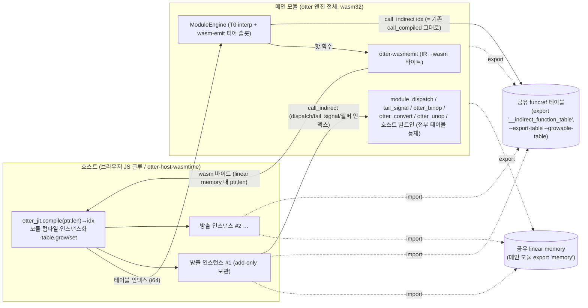

# O-13 설계 (최종본 v2) — wasm-emit 백엔드 (4번째 코드생성 티어) + WASI 동적 컴파일 호스트 계약

Status: **DESIGN v2 — 3렌즈 적대적 패널(A: ABI/아키텍처, B: IR 완전성/tier-parity, C: 호스트/WASI/테스트/규모) 반영 최종본.** otter stable 릴리즈의 최종 선결조건(사용자 결정 2026-09-02, `otter-reusability-plan.md:114-137`). 적용 정책: (a) otter tier-parity, (b) verify-before-implement, (c) PyPy 정확성-우선, (d) blast-radius 보수 추정.

이 문서의 모든 "실측"은 2026-09-02, 이 저장소의 고정 툴체인(stable 1.96.0, `rust-toolchain.toml:3`)으로 수행한 로컬 검증이며, 핵심 실측은 패널이 독립 재현했다.

---

## §0. 개정 요약 (패널 반영 결과)

**뒤집힌 핵심 결정: 없음.** §2 핵심 가설(fn 포인터 = 테이블 인덱스, call_indirect 성립)은 렌즈 A가 독립 프로브로 재실측해 전부 재현했고(패널 검증됨), §1 배포 구조·§3 (a)안·§5 계약 골격·§7 업스트림 사실관계도 3렌즈 모두에서 유지 판정을 받았다. 단, 다음이 **크게 바뀌었다**:

1. **§2.5 인자 마셜링 전면 재설계** (패널 A#1 CRITICAL·A#2 HIGH·B#1 HIGH): 1차안의 `Box<[Value;256]>` 단일 스크래치는 크기 산정이 IR 오독(argc는 u8 상한이 아님)이고 수명 논증이 차용-수명을 누락해 unsound. → 함수별 정확-크기 스크래치 + wasm-cfg `module_dispatch` 복사-즉시 변형으로 교체. §6의 "dispatch 루프 무변경" 주장 철회.
2. **§4 전면-헬퍼 방침에 Refuse 카브아웃 신설** (패널 A#3 HIGH·B#4): 정수 Div는 헬퍼 패닉 → nounwind abort → 못 잡는 wasm trap이 되므로 방출 전 사전검사에서 Refused.
3. **Neg(F16) 정본 의미론 수정이 선결 co-requisite로 승격** (패널 B#2 HIGH — 실측 반증): 현행 3티어는 Neg(F16)에서 이미 갈라져 있고(T0=T1≠T2) 셋 다 수치 오답 + T0은 자체 불변식 위반. `otter_unop` 신설 전에 정본 수정 필수. **사용자 승인 대상**(문서 말미 §12).
4. **§9 API 재설계** (패널 A#4·C#1): 헬퍼/호스트-fn 인덱스 취득을 파라미터로 외부화 — 그래야 §8(a) 네이티브 차등 하네스가 성립. 의존 표 정정(otter 의존 필요).
5. **방출 전 구조 사전검사 신설** (§4.6, 패널 A#5·B#3·B#5·A#3·B#4 통합): 끝-폴스루/트레일링 JumpIf/정수 Div/제어-Effect-후속을 한 메커니즘(→Refused)으로 차단.
6. **§8(c) 수락 기준 4→7항** (패널 C#4): 계약 실패 경로 + feature-off 회귀 + memory.grow 상호작용 추가.
7. **증분 계획 재구성** (패널 C#9): W-0.5(정본 co-requisite) 신설, W-1 이분할, 게스트 데모 크레이트 독립 산출물화(C#8), 하네스 규모 상향(C#6).

**패널 상호 충돌 판정 기록 (정확성/tier-parity 우선 원칙 적용)**:
- **Neg(F16)**: 렌즈 A는 "정수 wrapping_neg + norm이 기존 전-티어 합의이고 cranelift와 이미 일치"로 판정했으나, 렌즈 B는 스크래치 크레이트 실측으로 T2 divergence(0xFFFF…C400 vs 0x0000…C400)를 재현했다. **실측이 정적 독해에 우선하므로 B#2 채택, A의 '이미 일치' 판단은 기각.** A의 부속 주의("otter_unop은 eval을 축자 재사용, 손수 재구현 금지")는 수정된 eval에 적용하는 것으로 유지.
- **스크래치 수정안**: 렌즈 B#1은 "함수별 스크래치로 §2.5 수명 논증이 그대로 이식된다(재귀 포함)"고 봤으나, 렌즈 A#2는 함수별/콜사이트별 분리도 **차용-수명** 수준에서 unsound임을 반례(자기재귀에서 외부 활성화의 live `&[Value]` 아래 덮어쓰기)로 보였다. **차용 분석이 더 깊은 A#2를 채택하고, B#1에서는 크기 산정 방식(함수별 max argc 정확 할당)만 취한다.** 두 수정은 상보적이며 A 스스로 결합을 명시했다(§2.5).

---

## §1. 배포 아키텍처 확정 — 엔진-인-wasm (Jiterpreter 형태)

`.NET Jiterpreter`(프로덕션 선례, `wasm-emit-backend-research.md:39-41`)와 동형인 **emit-and-hand-to-host** 구조를 확정한다: otter 엔진 전체(otter + otter-engine + 신규 otter-wasmemit + 임베더 코드)가 wasm32로 컴파일되어 샌드박스 안에서 T0(인터프리터)로 실행되다가, 핫해진 함수를 wasm-emit 백엔드가 **런타임에 새 wasm 모듈 바이트로 lowering**해 호스트 임포트(`otter_jit.compile`)로 넘기고, 호스트가 컴파일·인스턴스화하여 **메인 모듈과 공유하는 funcref 테이블에 등록한 인덱스**를 돌려준다(Andy Wingo 2022 링킹 패턴, `wasm-emit-backend-research.md:67-70`).



**공유 자원 확정**:
- **linear memory 1개**: 메인 모듈의 것(디폴트로 `"memory"` export됨 — 실측, 패널 A 재현). 방출 모듈은 이를 import하므로 args 포인터/스크래치/`memory.grow` 가시성이 자동으로 동일 객체에서 성립.
- **funcref 테이블 1개**: 메인 모듈의 `__indirect_function_table`. **링커 플래그 `-C link-arg=--export-table -C link-arg=--growable-table` 필수** — 실측(패널 A 재현): 디폴트는 max=min·미export, 두 플래그로 max 제거 + export. 이 플래그는 rlib이 아니라 **최종 임베더 아티팩트의 링크**에 걸어야 하며(§5.3의 "임베더 빌드 요건" 절이 소유), 누락 시 발현은 다음과 같다(**W-0 실측 반영** — 패널 A#1 신규 실측으로 1차 서술 정정): 전누락 또는 `--export-table` 누락 → §5.3 3단계의 `-2`(테이블 임포트 실패); **`--growable-table`만 누락 → 링크·인스턴스화는 성립하고 첫 티어업의 `table.grow` 실패 `-4`로 지연 발현**. 에러 코드 문서에 두 원인을 각각 명기한다. (패널 A#9 반영)
- **방출 모듈들**: 함수당 1개, 최소 섹션(type/import/func/export/code)만 갖는 수백 바이트~수 KB 모듈. 함수 import **0개**(§2의 귀결), memory+table만 import. add-only — 호스트는 인스턴스를 영구 보관하고 테이블 슬롯을 절대 덮어쓰지 않는다(엔진 add-only 불변식 `otter-engine/src/lib.rs:18-20`과 정합).

**스코프 확정 (tier-parity 적용 범위)**: v1은 `ModuleEngine`(Dispatch 모드) 티어로만 존재한다. `CallMode::Table` AOT는 §8.10 정책 예외(`otter-o8-tailcall-design.md:445-453`), 단일함수 `Engine` 레이어(compile_fn/OSR)는 O-8c 카브아웃과 동일이며 `ModuleEngine`엔 OSR/Resumable 배선이 없다(**패널 검증됨** — 렌즈 A·B 각각 grep 0건 확인, 카브아웃이 정책 문서 원문과 정합 판정). 따라서 패리티 의무 = **ModuleEngine 경로의 Effect 8변형·Expr 10변형·NumTy 11폭 전부**이고 §4에서 실증한다.

---

## §2. 핵심 ABI 설계 — 가설 검증 결과: **성립 (실측 확인, 패널 독립 재현)**

### 2.1 가설과 검증 (패널 검증됨)

가설: "Rust/LLVM wasm32 ABI에서 함수 포인터는 `__indirect_function_table`의 인덱스이고, 함수 포인터 호출은 `call_indirect`로 컴파일된다. 따라서 호스트가 방출 함수를 같은 테이블에 등록해 인덱스를 돌려주면, 기존 `call_compiled`/주소-베이킹 관례 전체가 코드 변경 거의 없이 성립한다."

**검증**: otter 관례를 그대로 미러링한 프로브 크레이트(`HostFn1` 타입, `f as usize as i64` 베이킹, `transmute(addr) → f(x)` 호출, `CompiledFn`형 `call_compiled`)를 이 저장소 툴체인(1.96.0)으로 `wasm32-unknown-unknown` 컴파일 후 `wasm-tools print`로 확인. **렌즈 A가 동일 프로브를 독립 작성·재실측해 전 항목 재현**(패널 검증됨):

| 프로브 코드 (otter 관례 미러) | 생성된 wasm | 판정 |
|---|---|---|
| `(callee as HostFn1) as usize as i64` | `i32.const 1; i64.extend_i32_u` + `(elem (i32.const 1) func $callee)` | **fn 포인터 = 테이블 인덱스(상수)**. 인덱스 0은 널 |
| `transmute(addr as usize)` 후 `f(x)` | `i32.wrap_i64; call_indirect (type 1)` | **transmute+호출 = call_indirect** |
| `call_compiled(p,args,argc)` 미러 | `call_indirect (type 0)`, type 0 = `(param i32 i32 i64)(result i64)` | **엔진 호출 경로 무변경 성립** |

clang/LLVM wasm C ABI의 규정 동작이다. **결론: 가설 성립. 별도 간접 계층 불요.** `dispatch_addr()`/`tail_signal_addr()`(otter-engine/src/lib.rs:157-165)와 `call_compiled`의 transmute(otter-engine/src/lib.rs:502-512)는 **소스 무변경**으로 wasm에서 동작한다.

### 2.2 wasm32에서의 CompiledFn 정확한 시그니처 (패널 검증됨)

`type CompiledFn = extern "C" fn(*const ModuleEngine, *const Value, i64) -> Value`(otter-engine:151)는 wasm32에서:

```wat
(type $compiled (func (param i32 i32 i64) (result i64)))  ;; (ctx, args, argc) -> result — 실측 type 0과 동일
```

방출 모듈의 유일한 export 함수 `"f"`는 정확히 이 타입. wasm 타입 동등성은 구조적이므로 모듈 경계를 넘어 일치하고, 어긋나면 첫 호출에서 결정적 trap(§2.4).

- **args 로드**: `(i64.load offset=8*i (local.get $args))` + cranelift의 argc-가드 프롤로그(otter-cranelift:871-890) 재현: `(if (i64.gt_s (local.get $argc) (i64.const i)) ...)`. (**패널 검증됨** — 렌즈 B, SignedGreaterThan 동형 확인)
- **ctx 불투명 전달**: `$ctx`(i32)는 역참조 없이 dispatch/tail_signal의 첫 인자로만 전달(`opaque_ptr` 규율, otter-cranelift:853-862).
- **`host_ctx`/`fill` 베이킹**: `i64.const` 상수. host_ctx는 HostCtx1/2 호출에만, `opaque_ptr`과 절대 혼용 금지(otter/src/lib.rs:85-92). (**패널 검증됨** — 렌즈 B, 인자 순서·규율·OperandImm 부호확장 3경로 일치 확인)

### 2.3 otter-cranelift가 주소를 굽는 전 사이트 전수표와 wasm-emit 등가물

(**패널 검증됨** — 렌즈 B가 13개 사이트를 행별 대조: 누락 없음, 행번호 전부 정확. 단 #1/#3의 "인덱스 취득 위치"는 아래와 같이 정정 — 패널 A#4·C#1 반영)

**인덱스 취득 원칙 (패널 A#4·C#1 반영)**: 1차안의 "백엔드가 wasm 안에서 `otter::otter_binop as … as usize`로 스스로 취득"은 (i) x86_64 차등 하네스에서 그 표현식이 64비트 네이티브 주소를 반환해 §8(a)가 성립 불가, (ii) §9 API·의존 표와 모순이므로 **철회**한다. 확정: **모든 테이블 인덱스는 호출자(otter-engine의 wasm-cfg 코드 또는 하네스)가 취득해 `compile_dispatch_fn`의 파라미터로 전달**한다 — `HelperIdx { dispatch, tail, binop, convert, unop }` + 호스트 fn 포인터 리졸버 `resolve: &dyn Fn(usize) -> Option<u32>`(§9). wasm 배포에서는 리졸버가 `ptr as u32` 항등(§2 실측이 보장), 하네스에서는 "실제 네이티브 스텁 fn 주소 → 하네스가 고른 mock 인덱스" 매핑이다.

| # | 네이티브 사이트 (otter-cranelift/src/lib.rs) | 굽는 것 | wasm-emit 등가물 (방출 모듈 내) |
|---|---|---|---|
| 1 | `binop_addr()` :36-38 → `call_binop` :54-55 | `otter_binop` 실주소 | `i32.const <HelperIdx.binop>; call_indirect (i64 i64 i32 i32)→i64` — 인덱스는 파라미터로 수령(위 원칙) |
| 2 | `convert_addr()` :39-41 → `call_convert` :69-70 | `otter_convert` 실주소 | 동형, `(i64 i32 i32)→i64`, `HelperIdx.convert` |
| 3 | `call_host1` :83 | IR에 실린 `HostFn1` | `i32.const <resolve(f as usize)>; call_indirect (i64)→i64` — IR이 나르는 fn 포인터 값을 리졸버로 인덱스화해 굽는다 |
| 4 | `call_host2` :94 | `HostFn2` | 동형, `(i64 i64)→i64` |
| 5 | `call_host_ctx1` :110 | `HostFnCtx1` | 동형, `(i64 i64)→i64`, 첫 인자 `i64.const host_ctx` |
| 6 | `call_host_ctx2` :129 | `HostFnCtx2` | 동형, `(i64 i64 i64)→i64` |
| 7 | `CallMode::Dispatch` dispatch_addr :1040-1045 | `module_dispatch` 실주소 | `i32.const <HelperIdx.dispatch>; call_indirect (i32 i64 i32 i64)→i64` |
| 8 | TailCall tail_addr :991-1000 | `tail_signal` 실주소 | #7과 동일 타입·형태(`HelperIdx.tail`), 결과 drop 후 `return fill`(§4) |
| 9 | `fill`/`host_ctx` iconst :866-867 | 모듈 상수 | `i64.const` (주소 아님) |
| 10 | 인자 마셜링 `stack_slot`+`stack_addr` :969-983, 1014-1028 | 프레임 내 버퍼 주소 | **유일한 구조적 차이** — §2.5 재설계로 해소 |
| 11 | Table 모드 `table[callee]` 로드 :1032-1039 | fn-ptr 테이블 | **범위 밖** (§1 스코프) |
| 12 | (엔진) `dispatch_addr()`/`tail_signal_addr()` otter-engine:157-165 | Rust fn 포인터 | **소스 무변경** — wasm 컴파일 시 자동으로 테이블 인덱스 |
| 13 | (엔진) `call_compiled` transmute otter-engine:502-512 | `*const u8` → fn | **소스 무변경** — 실측 `call_indirect (type 0)` |

### 2.4 시그니처 불일치 등 wasm trap의 처리 — 계약 규범으로 격상 (패널 A#6 반영)

wasm `call_indirect`는 런타임 타입 대조 실패 시 결정적 trap(네이티브 UB보다 강한 보장). trap은 wasm 예외(§7 EH)로 잡을 수 **없고**, 정밀하게는: **활성화(activation) 전체를 Drop 실행 없이 unwind**한다. 인스턴스 자체는 기술적으로 재호출 가능하게 남지만, trap 순간 live였던 `RefCell` 가드(`pushed.borrow()`, `tail_args.borrow_mut()` 등)의 해제가 영원히 일어나지 않으므로 재진입 시 다음 borrow에서 패닉이 연쇄한다. O-10 clear_trap의 보장("RAII Drop이 언와인드 중에도 실행", otter-engine:751-761)은 **Rust 패닉 언와인드 전제**라 wasm trap에는 적용되지 않는다.

**계약 규범(단순 문서화가 아님)**: *wasm trap 발생 시 해당 엔진(사실상 인스턴스)은 폐기 대상이며, trap 이후의 `clear_trap`/재진입 동작은 정의되지 않는다.* try_dispatch의 wasm판 계약 서술에 이를 명기한다. 처리 방침: (i) 시그니처는 전부 이 문서 표로 고정·기계 방출되므로 불일치는 백엔드 버그 — §8(a) 하네스가 전 타입을 실제 wasmtime 인스턴스화·호출로 사전 차단, (ii) 잔존 버그의 폭발 반경은 "활성화 사망 + 상태 무결성 상실"(호스트가 trap을 잡아 세션 종료 처리)이며 메모리 안전 위반이 아님(§11 위험 8).

### 2.5 인자 마셜링 — 전면 재설계 (패널 A#1·A#2·B#1·C#3 반영; 1차안 폐기)

**1차안(엔진 소유 `Box<[Value; 256]>` 단일 스크래치 + 값-수명 논증)은 패널에서 이중으로 반증되었다**:

- **크기 오류 (A#1 CRITICAL, B#1 HIGH — 동일 오독을 독립 발견)**: `Call { dest, base, argc: u8 }`의 `u8`은 **피연산자 슬롯 인덱스이지 인자 개수 상한이 아니다**(otter/src/lib.rs:449-450 독스트링 "operand indices"; 실소비는 세 티어 모두 `inst.operand(*argc) as usize` — interp :888, cranelift :1012, tail :901). 실상한은 `check_func`의 `base+1+argc <= nlocals`(:1697-1704) + `MAX_SAFE_NLOCALS ≈ 6,710만`(:1667). 즉 argc=1,000짜리 **정당한** 함수가 존재하고, 256 슬롯 고정 스크래치는 trap도 패닉도 없이 인접 게스트 힙(엔진 자신의 상태 포함)을 오염시킨다 — O-12가 최악 클래스로 규정한 패닉-없는 메모리 손상의 신규 도입. 부기: 오독의 씨앗인 otter-engine:862의 기존 주석 "`argc` is `u8`-bounded"도 **오류이므로 함께 정정**한다(tail_args 실상한은 nlocals 유도).
- **수명 오류 (A#2 HIGH)**: 값-수명 논증은 **차용-수명**을 다루지 않는다. `module_dispatch`가 스크래치 위에 형성한 `&[Value]`(otter-engine:814-818)는 T0 콜리의 `run_one(args=cur)` 호출 전체 동안 live인데, 그 안의 중첩 컴파일드 콜리가 같은 스크래치에 store하면 rustc가 부여한 noalias/readonly 위반 = LLVM 수준 UB(O-9에서 주소 안정성에 적용한 것과 동일 기준으로 실격). **함수별/콜사이트별 분리도 자기재귀에서 같은 이유로 unsound**(활성화별 분리가 아니므로 — 네이티브 cranelift가 안전한 이유는 활성화별 스택 슬롯이기 때문).

**확정 설계 (A#2 수정안 (a) + B#1 크기 산정의 결합 — §0 판정 기록 참조)**:

1. **함수별 정확-크기 스크래치**: lowering 시점에 함수 내 전 Call/TailCall 사이트의 argc(각 사이트에서 `inst.operand(argc_op)`는 컴파일타임 상수)를 스캔해 `max_n`을 구하고, `max_n × 8` 바이트를 **`WasmSlot::Compiled` 핸들이 소유**(주소 베이킹 전 할당, add-only → 주소 불변). Call/TailCall lowering은 `i64.store offset=8k`로 여기에 쓰고 그 주소를 dispatch/tail_signal에 넘긴다.
2. **wasm-cfg `module_dispatch` 복사-즉시 변형**: `cfg(all(target_family="wasm", feature="wasm-emit"))`에서 module_dispatch는 슬라이스 형성 즉시 **소유 Vec으로 복사하고 슬라이스를 폐기한 뒤 `dispatch(&vec)`를 호출**한다. `tail_signal`은 이미 이 구조라 무변경(otter-engine:865-874 — **패널 A 검증됨**: 복사가 중첩 실행 전에 완료되므로 현행 sound). 이로써 스크래치의 live 차용 구간은 "호출자 store → 진입 복사 루프"로 축소되며, 그 창 안에서는 어떤 게스트/호스트 코드도 실행되지 않는다. 비용: 컴파일드 Call당 Vec 1개 = T0의 `argv` 할당(:890)과 동급 — PyPy 정확성-우선 정합.
3. **§6 정정**: 1차안의 "call_compiled/dispatch 루프: 무변경" 중 **module_dispatch 부분을 철회**한다. `call_compiled`/`dispatch_addr`/`tail_signal_addr`/디스패치 루프 본체는 여전히 무변경.
4. **전제 재스코프 (C#3)**: 1차안의 "호스트는 게스트 linear memory에 절대 쓰지 않는다"는 WASI 임포트(`fd_read`/`args_get` 등)의 존재 이유와 모순되어 계약 전체로는 거짓. 규범을 두 문장으로 재스코프: **"`otter_jit.compile`의 구현은 게스트 메모리에 쓰지 않는다"** + **"스크래치 주소는 다른 어떤 호스트 임포트에도 전달되지 않는다"**(§5.3-7). 단 위 2의 복사-즉시 설계 채택으로 스크래치 건전성은 이 전제에 더 이상 의존하지 않는다(심층 방어로 강등).
5. **하네스 의무**: argc=255/256/257/1000 경계 차등 + 자기재귀/중첩 마셜링 시나리오(§8a).

**플랜 B (perf, W-후속)**: 엔진 소유 범프 인자-스택(활성화별 LIFO — 네이티브 스택 슬롯과 동형, A#2 수정안 (b)) — v1 미채택(신규 위험 코드).

---

## §3. 제어흐름 lowering 전략 — **(a) 디스패처-루프 확정** (골격 유지, 패널 A#5·B#3 반영)

otter 코드는 pc-인덱스 선형 배열 + 임의 `JumpTo`/`JumpIf`로 reducibility 보장이 없다(`wasm-emit-backend-research.md:64-66`). 1차 비교표(정확성/프리아트/의존성/성능/방법론)에 따라 **v1 = (a) 디스패처-루프, waffle 미채택**(§9)을 유지한다. 구조적 재구성(stackifier식 직접 lowering)은 순수 성능 후속 증분(W-후속)으로 유보하고, 디스패처-루프를 영구 폴백으로 유지한다.

기본블록 리더 도출은 cranelift와 동일 알고리즘 재사용(`is_terminator`+`branch_targets`+낙하 리더, otter-cranelift:141-173, 825-846; `is_terminator`의 TailCall 포함은 **패널 검증됨** — 렌즈 B, :143-151에 이미 존재, U2 재발 없음):

```wat
(func $f (param $ctx i32) (param $args i32) (param $argc i64) (result i64)
  (local $l0 i64) … (local $state i32)          ;; otter 로컬 → wasm i64 로컬 (레지스터 할당은 호스트 JIT에 위임)
  ;; 프롤로그: 전 로컬 fill → argc-가드 파라미터 로드 → consts 상수 세팅 (§2.2)
  (loop $top
    (block $bN … (block $b1 (block $b0
      (br_table $b0 $b1 … $bN $trapblk (local.get $state)))
      ;; 리더 0의 코드 …
    ) … )
  )
  unreachable)   ;; $trapblk — 커버 범위는 아래 정정 참조
```

**패널 반영 정정 2건**:
- **낙하-경계 방출 규칙 명문화 (B#3)**: 비-터미네이터 Effect 열이 리더 경계로 낙하할 때는 `i32.const <다음 리더 순번>; local.set $state; br $top`을 방출한다(cranelift의 `if !terminated { jump }` :924-927 등가). JumpIf는 양쪽 분기 모두 리더 경유(낙하도 리더 — cranelift :536 블록 규율).
- **`$trapblk` 도달불가 주장 축소 (A#5·B#3)**: 1차안의 "check_func가 배제하므로 default 도달 불가"는 **명시 점프 타깃에만 참**이다. `check_func`(:1781-1836)는 (a) 마지막 명령이 터미네이터인지, (b) `JumpIf`가 code 끝에서 폴스루하는지 검사하지 않는다(양 렌즈 독립 확인). 이 형상들은 §4.6 **방출 전 구조 사전검사**가 Refused로 배제하므로, `$trapblk unreachable`의 커버 범위는 "**state 값 손상뿐**"이다. 정적으로 탐지 가능한 형상에 런타임 `unreachable`을 절대 쓰지 않는다는 원칙을 규범화한다(B#3).

---

## §4. 명령어/Expr lowering 전수표 — 기능 갭 실증 (패널 A#3·B#2·B#4·B#5 반영)

**Bin/Un 방침 (v1 vs 후속)**: v1은 모든 `Bin`/`Un`을 `otter_binop`/`otter_convert`/`otter_unop` 헬퍼 위임으로 통일한다. 근거: (i) 헬퍼는 메인 모듈 안의 정본 인터프리터 의미론 그 자체(otter/src/lib.rs:199-212)이므로 11개 NumTy 폭·`half` 소프트플로트 f16 포함 비트동일성이 구성적으로 보장, (ii) PyPy 정확성-우선. **단 다음 두 카브아웃이 신설된다**:

- **정수 Div → Refused (패널 A#3 HIGH·B#4 반영)**: `BinOp::eval`의 정수 `Div`는 `unreachable!` 패닉(otter/src/lib.rs:290)이다. 네이티브에선 T0 실행 중 패닉(catch_unwind 격리) 또는 cranelift **컴파일 타임** 패닉(:397, 격리·포이즌·회복 가능)이지만, wasm에서 헬퍼 위임으로 컴파일에 성공시키면 첫 실행 시 `otter_binop`(catch_unwind 없는 `extern "C"`, otter는 `forbid(unsafe_code)` no_std라 래핑 불가) 내부 패닉 → nounwind 경계 abort → **EH로도 못 잡는 wasm trap = 활성화 사망**(§2.4) — try_dispatch 계약과 실패-모드 tier-parity의 동시 회귀이며, §7에서 (b)안을 기각한 근거가 이 경로로 재발한다. **수정**: §4.6 사전검사에서 `Bin{ty: 정수, op: Div}` 포함 함수를 Refused(sticky, T0 잔류 → 패닉은 기존 격리 경로로 수렴 = 네이티브 실패 모드의 최선 근사). **일반 원칙으로 명문화**: *방출 코드에서 도달 가능한 모든 헬퍼(`otter_binop`/`otter_convert`/`otter_unop`)는 백엔드가 굽는 인자 도메인에서 전-패닉-프리임을 lowering이 정적으로 보장한다(불가하면 Refuse).* §8(a)에 정수 Div Refuse 회귀 케이스 추가.
- **헬퍼 전수성 표 (패널 B#4 반영)**: `otter_convert` 전역 total(:351-391), `otter_unop`(정본 수정 후) total, `otter_binop`은 정수 Div만 부분함수. 태그는 백엔드가 굽는 상수라 `from_tag` OOB 불가.

후속 perf 증분(W-후속): int 전폭·f32/f64의 wasm 네이티브 op 하강(trunc_sat 의미론은 Rust `as`와 정합; 협폭 클램프는 cranelift `clamp_to_width`:220-234 동일 로직 필요). **f16은 영구 헬퍼 경유**(네이티브 op 부재; `half-codec`/`f16-intrinsic` 교차-config 불변 계약도 자동 충족 — 프로덕션에선 T0과 Twasm이 같은 인스턴스의 같은 헬퍼 코드를 실행하므로 구성적 동일: **패널 검증됨**, 렌즈 B. 단 W-후속 float 하강 시 wasm NaN 정규화 divergence 위험은 그 증분으로 이월 — §11 위험 16).

### 4.1 선결 co-requisite — Neg(F16) 정본 의미론 수정 (패널 B#2 HIGH 반영; §0 충돌 판정 참조)

렌즈 B의 실측(입력 0x3C00 = 1.0f16): T0 `UnOp::eval` = `0xFFFF_FFFF_FFFF_C400`(64비트 전체 2의 보수 — NumTy "low bits, rest zero" 불변식 :121-122 위반), T1 = T0과 동일(우연), T2 cranelift = `0x0000_0000_0000_C400`(**T0/T1과 비트 불일치 — 이미 갈라져 있음**), IEEE 정답 = `0xBC00`(셋 다 수치 오답). 원인: `UnOp::eval`(:340-344)이 F64/F32만 부호 반전 특별취급하고 F16은 정수 arm으로 낙하; cranelift의 Bin/Convert는 F16을 헬퍼로 우회하나(:239, :312) Neg만 누출. 따라서 1차안의 "헬퍼 = 정본이므로 구성적 비트동일" 주장은 Neg(F16)에서 거짓이고, `otter_unop`을 그대로 신설하면 깨진 의미론을 공개 FFI로 동결하면서 T2와의 비트동일에도 실패한다(Twasm=T0=T1≠T2).

**수정안 (W-0.5 증분, 자체 패널 + 사용자 승인 — §12)**: ① `UnOp::eval`에 F16 arm 추가 — IEEE 부호 반전 `((a as u16) ^ 0x8000) as Value`(F32/F64 fneg와 동형, NaN 페이로드 보존; f64 왕복 변환은 NaN에서 달라지므로 금지), ② cranelift Neg(F16)을 헬퍼 경유 또는 xor로 정렬, ③ baseline 동일, ④ 3티어+wasm 차등 하네스에 **Un(Neg/Convert)×11 NumTy** 커버리지 추가(현행 cranelift LCG fuzz는 i64 Bin 4종뿐 — :1500-1508), ⑤ 그 후 `otter_unop` 신설(`pub extern "C" fn otter_unop(a: Value, op_tag..) -> Value`, otter_binop :201-203 동일 패턴, IR 추가 아님 — FFI 헬퍼 추가라 3티어 무영향). otter_unop은 **수정된** `UnOp::eval`을 축자 재사용한다(손수 재구현 금지 — 렌즈 A 주의사항을 수정된 정본에 적용). 이는 바이트코드 관측 결과를 바꾸는 정본 의미론 수정이므로 사용자 확정 대상(§12-2).

### 4.2 Expr 10변형

(**패널 검증됨** — 렌즈 B: Expr 10종 enum 대조, 누락 variant 없음. 아래 표의 변경은 의미론 오류 정정이지 누락 보충이 아님)

| Expr | wasm lowering | 근거/비고 |
|---|---|---|
| `Imm(v)` | `i64.const v` | cranelift :303 동형 |
| `ImmF64(f)` | `i64.const f.to_bits()` | :304 동형 |
| `OperandImm(i)` | `i64.const (operand as i64)` — 컴파일타임 상수, i32→i64 부호확장 | :305 동형 (**패널 검증됨** — 3경로 일치) |
| `LocalAt(i)` | `local.get $l<operand(i)>` | :306 동형; check_func `LocalOutOfRange` 사전 증명 |
| `Bin(op,a,b)` | `x, y, i32.const ty.tag, i32.const op.tag; i32.const <HelperIdx.binop>; call_indirect (i64 i64 i32 i32)→i64` | v1 전면 헬퍼; **정수 Div는 §4.6에서 Refused** (패널 A#3·B#4) |
| `Un(Neg(ty),a)` | `x, i32.const tag; i32.const <HelperIdx.unop>; call_indirect` — **`otter_unop` 경유 (W-0.5 정본 수정 후 신설)** | 패널 B#2 반영 — §4.1 |
| `Un(Convert,a)` | `otter_convert` 헬퍼, `HelperIdx.convert` | total (§4 전수성 표) |
| `Host1(f,a)` | `x; i32.const <resolve(f)>; call_indirect (i64)→i64` | §2.3 #3 — 리졸버 경유 (패널 A#4·C#1) |
| `Host2(f,a,b)` | 동형 `(i64 i64)→i64` | #4 |
| `HostCtx1/2(f,…)` | `i64.const host_ctx` 선행, 동형 | #5-6; host_ctx≠ctx 규율 (**패널 검증됨**) |

### 4.3 Effect 8변형

(**패널 검증됨** — 렌즈 B: Effect 8종 enum 대조, 누락 variant 없음)

| Effect | wasm lowering | 근거/비고 |
|---|---|---|
| `SetLocalAt{reg,value}` | eval → `local.set` | cranelift :935-938 동형 |
| `JumpTo{target}` | `i32.const <leader#>; local.set $state; br $top` | §3 |
| `JumpIf{cond,target}` | eval → `i64.eqz; if/else`로 $state 세팅 → `br $top` (양쪽 리더 경유) | §3; 트레일링 JumpIf(pc+1==code_len)는 §4.6 Refused |
| `Guard{cond}` | **no-op** | (**패널 검증됨** — 렌즈 B: run_one :884·run_module :770·cranelift :956 전부 no-op, deopt는 Engine 레이어 전용 — 패리티 위반 아님 판단 정확) |
| `Halt{value}` / `Return{value}` | eval → `return` | :949-955 동형 |
| `Call{dest,base,argc}` | args를 **함수별 스크래치**(§2.5)에 `i64.store` ×n → `local.get $ctx; local.get $l<base>; i32.const <scratch>; i64.const n; i32.const <HelperIdx.dispatch>; call_indirect (i32 i64 i32 i64)→i64` → `local.set $l<dest>` | 같은 테이블 인덱스 경유로 메인 모듈 `module_dispatch`(**복사-즉시 변형**, §2.5-2)에 재진입. 콜리는 자기 현재 티어로 실행 |
| `TailCall{base,argc}` | 마셜링 동일 → `call_indirect <HelperIdx.tail>` → `drop` → `i64.const fill; return` | **기존 tail_signal 트램폴린 유지, `return_call` 미사용** — 콜리가 T0일 수 있어 디스패처 트램폴린 필수(**패널 검증됨** — 렌즈 A·B 모두 타당 판정; O-8c §8.3 창 논증이 순수 wasm 에필로그로 성립, 유계성 = 디스패처 1 + 함수 1). 자기-꼬리호출 `return_call` 최적화는 순수 perf 후속 |

**추가 카브아웃 (패널 B#5 반영)**: T0 `run_one`은 `JumpTo`/`JumpIf` 뒤의 **나머지 Effect를 계속 실행**하지만(:629-636, :875-879), wasm 디스패처-루프에서 `br $top` 뒤 방출분은 유효한 dead code로 검증을 통과해 **침묵 divergence**가 된다(네이티브 cranelift는 컴파일 타임에 시끄럽게 실패 — 격리됨). §4.6 사전검사에 "제어 Effect(JumpTo/JumpIf/Halt/Return/TailCall)가 OpDef의 마지막 Effect가 아니면 Refused"를 추가하고, 이 계약을 `Effect` 독스트링으로 승격한다(프레임워크 레벨 명문화).

### 4.6 방출 전 구조 사전검사 (신설 — 패널 A#3·A#5·B#3·B#4·B#5 통합 반영)

`check_func` 통과 **후**, lowering **전**에 백엔드가 수행하는 정적 검사. 하나라도 걸리면 **Refused**(sticky, T0 잔류 — Refuse는 패리티 위반이 아니라 네이티브의 컴파일타임 실패를 깨끗한 Refusal로 미러링하는 것):

1. 마지막 인스트럭션이 터미네이터가 아니면 Refuse (끝-폴스루 — A#5·B#3).
2. 어떤 `JumpIf`든 `pc+1 == code_len`이면 Refuse (트레일링 JumpIf — A#5·B#3).
3. `Bin{ty: 정수, op: Div}`가 존재하면 Refuse (헬퍼 패닉 표면 — A#3·B#4).
4. 제어 Effect가 OpDef의 마지막 Effect가 아니면 Refuse (dead-code divergence — B#5).
5. (W-1b 반영 — W-1a 패널 #2a 렌즈 A#2 이월분의 본문 명문화; 패널 #2b 렌즈 C#3) 방출 함수의 wasm 로컬 수 `nlocals + 4`(3 `CompiledFn` 파라미터 + 디스패처 `$state`, **균일 계상**)가 wasm 엔진 구현 캡 `MAX_WASM_FUNCTION_LOCALS`(50,000, 파라미터 포함 — wasmparser/wasmtime/V8 공통)을 넘으면 Refuse (`Refusal::WasmLocalsLimitExceeded`). 캡을 넘는 함수는 otter IR로는 유효해도 어떤 엔진의 검증기도 통과하지 못하는 바이트가 되므로("known implementation-limit gap"), `Ok` ⇒ 검증-통과 모듈 계약을 위해 사전 Refuse한다. 균일 계상이라 경계는 디스패처 함수에선 정확하고, `$state`를 안 쓰는 직선 함수는 1슬롯 이르게 refuse된다(보수적 방향 — 패널 #2b 렌즈 C#2에서 실측·문서화).

부기 (W-1b 반영, anti-wrap 가드): §3 디스패처의 `$state`는 i32이고 `br_table` 라벨은 u32이므로, 리더 수가 `i32::MAX`를 넘으면 침묵 wrap 캐스트 = 미스컴파일이 된다. 이는 엔진 한계(5항)가 아니라 인코딩 한계로, 별도 변형 `Refusal::TooManyLeaders`가 Refuse로 총체화한다 — 실제 도달에는 ≥2³¹ 인스트럭션(≥32 GiB `code`)이 필요해 사실상 테스트 불가하지만, "`Ok` ⇒ 검증-통과 모듈" 계약을 확률적이 아니라 전역적으로 유지하기 위해 존재한다. (sub-`i32::MAX`인데도 호스트가 거부하는 br_table — 예: V8의 ~65,520 타깃 캡 — 은 설계대로 §5.1 호스트 측 `-1` → sticky-Refused 강등으로 처리.)

원칙: *정적으로 탐지 가능한 형상에 런타임 `unreachable`을 절대 쓰지 않는다.* 대안으로 검토한 `otter::validate`에의 additive 검사(`FallsOffEnd` 등) 추가는 기존 티어들의 관측 동작(T0 OOB 패닉 격리 등)을 바꾸므로 v1 미채택 — 백엔드 국소 검사로 한정한다. §8(a)에 1-5 각각의 Refuse 회귀 케이스를 추가한다.

**갭 실증 (정정판)**: Effect 8/8, Expr 10/10, NumTy 11/11(헬퍼 경유), TailCall 유계성 전부 커버, `unimplemented!` 잔존 0. **단 이 선언은 W-0.5(Neg(F16) 정본 수정, §4.1) 완료를 전제**로 한다 — 그 전에는 Neg(F16)에서 티어들이 이미 갈라져 있어 "갭 0"을 선언할 수 없다(패널 B#2). §4.6의 Refuse 카브아웃들은 기능 갭이 아니다(해당 형상은 T0에서도 정상 완주가 아닌 패닉/trap 형상이며, Refuse → T0 잔류로 기존 실패 모드가 보존됨). 완료 시점에 §8.10 wasm 예외조항은 자동 소멸 조건을 충족한다(otter-o8-tailcall-design.md:477-479).

---

## §5. 호스트 계약 (O-13b) 사양

WASI에 동적 컴파일 임포트 표준이 없으므로(WASI#477, component-model#401/#423) otter가 자체 계약을 정의한다. **사양 문서만으로 불충분, wasmtime 참조 구현 + 실동작 데모가 수락 조건**(사용자 결정, otter-reusability-plan.md:125-129).

**계약 버전 (패널 C#10 반영)**: 이 계약은 **v1이며 otter stable 태깅까지 불안정**이다. 임포트 이름 `otter_jit.version`은 향후 버전 협상용으로 **예약**한다(v1 미구현 — 미배선 호스트와의 링크 실패를 피하기 위해 v1 메인 모듈은 이를 임포트하지 않는다).

### 5.1 메인 모듈이 임포트하는 것 (네임스페이스 `otter_jit`)

```rust
#[link(wasm_import_module = "otter_jit")]
unsafe extern "C" {
    /// linear memory [ptr, ptr+len)의 wasm 모듈 바이트를 컴파일·인스턴스화하고, export "f"를
    /// 공유 funcref 테이블에 등록한 뒤 그 인덱스(>0)를 반환. 실패는 음수 에러 코드.
    fn compile(ptr: u32, len: u32) -> i64;
}
```

**에러 코드 규범 (문구 확정, W-6 — W-0 처분 A#6)**: 음수라는 **부호만이 규범**(normative — 엔진의 유일한 관측은 "양수 인덱스냐 아니냐"이고, 어떤 음수든 처리는 동일하게 sticky Refused다). 아래의 **세분값 배정은 진단 SHOULD** — 호스트는 실패 원인에 맞는 세분값을 반환하는 것이 좋고(SHOULD) 임베더 디버깅이 그에 의존하지만, 세분값을 뭉뚱그리는 호스트도 계약 위반은 아니다.

에러 코드(음수): `-1` 검증/컴파일 실패(**호스트 구현 한계로 인한 거부 포함** — 크기·br_table 타깃 수·로컬 수 상한 등, 아래 참조; **ptr/len이 게스트 linear memory 범위를 벗어나는 읽기 요청도 이 클래스다** — W-6 명문화, W-0 처분 A#5: 참조 shim은 `ptr+len > memory.data_size`를 할당 **전에** 검사해 `-1` 반환, 게스트 부작용 0), `-2` 인스턴스화 실패(**빈발 원인: 임베더가 링크 플래그를 전누락하거나 `--export-table`을 누락** — §5.3 임베더 빌드 요건, 패널 A#9), `-3` export "f" 부재/타입 불일치, `-4` 테이블 grow 실패(**빈발 원인: `--growable-table`만 누락 — 비-growable 테이블과도 링크는 성립하고 첫 티어업 grow에서 지연 발현. W-0 실측 반영, 패널 A#1; 자원 고갈로 오독 금지**), `-5` 기능 비활성(**지위 확정, W-6 — W-5 B#4**: **예약됨**. 참조 shim은 "미배선"을 이 코드가 아니라 **임포트 부재 = 인스턴스화 시점 링크 실패**로 표현하므로(`--no-otter-jit` 모드 — feature-ON 게스트는 정확한 unresolved-import 에러로 실패하고, 그 실패 자체가 계약이다) **-5를 생산하지 않는다**. -5는 `otter_jit`을 **배선하되 기능만 끈** 호스트 — 예: 정책/설정으로 동적 컴파일을 거부하는 임베더 — 를 위한 코드로 존속하며, 엔진 측 처리는 다른 음수와 동일(sticky Refused)). 반환 `>0` = 테이블 인덱스.

**엔진 측 방어 (패널 B#6·A#8 반영)**: 계약상 0은 절대 반환 금지(널 슬롯)지만, 엔진은 **`idx <= 0 || idx > u32::MAX`면 Refused로 처리**한다(계약 위반을 게스트가 흡수 — 버그 있는 글루의 0 반환이 널 funcref trap으로 이어지는 것을 차단). 음수/범위 밖 수신 시 그 함수를 **Refused로 캐시**(O-8 픽스 T5/T8 sticky-거부 패턴)하고 영구 T0 유지 — 재시도 루프 없음.

**Refused 강등 경로는 load-bearing이다 (패널 A#8 반영)**: `check_func`를 통과한 정당한 함수도 호스트 한계(V8 계열 br_table 타깃 상한 ~65,520 — 리더 수는 code_len 비례, 함수당 로컬 상한 50,000 — nlocals ≤ 6,710만과 대비, 함수 바디 크기 상한)로 `-1`을 받을 수 있다. 이는 오류가 아니라 정상 강등이며, §8(a)에 대형 함수 케이스로 회귀 고정한다.

**임포트 부재 문제**: core wasm에 선택적 임포트가 없어 `otter_jit` 미배선 런타임에서는 메인 모듈 인스턴스화가 실패한다. 해소: **cargo feature `wasm-emit`**(otter-engine, wasm 타깃 한정) 게이트 — 미활성 빌드는 임포트 선언이 없어 "**wasm EH 지원** WASI 런타임에 얹으면 T0"(O-7 충족)가 유지된다. *(W-6 자구 정정 — W-5 F1: 초안의 "아무 WASI 런타임"은 과대 서술. §7 구성 산물은 feature-off여도 exnref(`try_table`/`throw_ref`)를 포함하므로, EH 미지원 런타임은 파싱 단계에서 거부한다 — "미배선이어도 되는" 것은 `otter_jit` 임포트뿐이고 EH 지원은 §7 빌드 산물의 전제.)* O-7과 달리 임포트 유무가 링크 표면을 바꾸므로 feature가 불가피하다(**패널 검증됨** — 이의 없음; §8(c)-6의 feature-off 회귀 게이트로 통제, 패널 C#4-ii).

### 5.2 방출 모듈이 임포트하는 것 — memory + table만 (함수 임포트 0)

```wat
;; memory 임포트 형상은 v1.1(O-17)부터 게스트 메모리의 공유 여부로 파라미터화된다 (아래 표):
(import "otter" "memory" (memory 0))               ;; [기본] 비공유 게스트: min 0 → 어떤 현재 크기와도 링크
(import "otter" "memory" (memory 0 65536 shared))  ;; [v1.1] +atomics(공유 선형 메모리) 게스트 빌드
(import "otter" "table"  (table 0 funcref))        ;; min 0, max 없음 (무변경)
```

| 임포트 | 형상 | 근거 (O-17 스파이크 M5 실측) |
|---|---|---|
| `otter.memory` (비공유 게스트, 기본) | `(memory 0)` — min 0, max 무선언, 비공유 | min 0 ≤ 모든 실제 min, max 무선언 ⇒ 상한 제약 없음 — 비공유 클래스의 보편 슈퍼타입 |
| `otter.memory` (+atomics 게스트, v1.1) | `(memory 0 65536 shared)` — min 0, **max 65536(= wasm32 전체 4 GiB)**, shared | shared 메모리는 max 선언이 **검증 필수**이고, 표준 limits 서브타이핑(선언min ≤ 실제min ∧ 선언max ≥ 실제max ∧ **shared 정확 일치, 양방향 무강제**)상 65536 ≥ 모든 wasm32 실제 max — shared 클래스의 보편 슈퍼타입. `memory.grow`는 메모리 **타입**을 바꾸지 않으므로 매칭은 인스턴스 수명 동안 안정 |
| `otter.table` | `(table 0 funcref)` (무변경) | O-17은 테이블 공유를 다루지 않음 (shared-everything-threads 밖 — 관망) |

§2 가설 성립의 직접 귀결 — 전 도달 대상이 테이블 인덱스 `call_indirect`이므로 함수 임포트 불요. export는 `(export "f" (func $f))` 하나. (**패널 검증됨** — 렌즈 C: min-0·max-부재 임포트는 어떤 export 메모리/growable 테이블과도 링크됨을 확인. **W-0 실측 반영** — 패널 A#1: min-0·max-부재 임포트는 wasm 임포트 서브타이핑상 max 제약이 없어 **비-growable(max=min) 테이블과도 링크가 성립**하며, 실패는 `table.grow` 시점의 `-4`로 지연된다 — §5.1 에러 코드 참조)

**스레딩 전제 규범 — v1.1 개정 (O-17, 2026-09-03; 초판 패널 C#11의 '비공유 한정' 스코프 결정을 실측 기반으로 상향)**: v1 초판의 "메인 모듈이 atomics+shared memory로 빌드되면 방출 모듈의 `(memory 0)` 임포트는 인스턴스화에 실패한다"는 O-17 4중 조합 실측(§7 핀 nightly-2026-08-31 × +atomics × --shared-memory × exnref × wasmtime 48)으로 해소되었다:

- **방출 측**: otter-wasmemit의 memory 임포트 타입이 파라미터화됨(`EmitOpts::shared_memory` — `compile_dispatch_fn`은 비공유 기본 불변). otter-engine은 `cfg!(target_feature = "atomics")`(컴파일 타임 자기-인지)로 shared 형상을 선택한다.
- **호스트 요건 (§5.3에 추가되는 v1.1 규범)**: shared 게스트를 수용하려는 호스트는 (i) atomics/shared **검증** 지원(wasmtime: crate feature `threads` — 48에서 검증은 feature만 있으면 기본 ON; **비공유여도 atomics 명령이 있으면 필요**), (ii) shared 메모리 **인스턴스화** 지원(wasmtime: `Config::shared_memory(true)` — 45 이전부터 존재하는 기본 OFF 노브, 48에서도 유지), (iii) §5.3-1/-3에서 export가 `SharedMemory`로 오는 분기(read + 배선)를 구현해야 한다(MUST, shared 수용 시). 이를 갖추지 않은 호스트에서 shared 게스트는 로드/인스턴스화가 실패하며 — 그 실패가 계약이다(§5.1의 강등·실패 경로 준용).
- **단일-에이전트 규범은 유지**: 공유 메모리는 *링크 호환*(수동적 호환, L0)일 뿐이며 엔진은 단일 스레드로만 실행된다 — 동시 실행·wasi-threads·스레드 스폰은 v1.1에도 계약 밖(wasip1-threads는 **금지 트랙**: wasmtime 47에서 제거됨). 스크래치 버퍼(§2.5)의 경합은 동시 실행 부재로 원리적으로 발생하지 않는다.
- 상세 실측·형상 결정 규칙·잔여 갭: `.claude-research-library/otter-o17-shared-memory-l0.md` (O-17 설계 노트).

**start 섹션 부재 규범 (W-0 패널 A#2 반영, W-1a 선결)**: 방출 모듈은 **start 섹션을 절대 갖지 않는다**(백엔드가 구조적으로 보장 — type/import/func/export/code 섹션만 방출). 호스트 shim은 start 섹션이 있는 모듈을 `-1`로 거부해도 된다(MAY) — 인스턴스화 시점에 게스트 스택 위에서 임의 코드가 실행되는 것을 계약 수준에서 차단(§13-4의 재진입 금지와 같은 위협 모델).

### 5.3 호스트가 해야 할 일 (계약 규범부)

1. `compile(ptr,len)` 수신 → 메인 인스턴스의 export memory에서 바이트를 읽는다(호출 시점 신선한 뷰 — §5.4).
2. 모듈 컴파일(검증 포함). 실패/한계 초과 → `-1`. **(W-5 반영 — W-0 처분 A#2)** wasmtime 참조 shim은 start 섹션이 있는 모듈을 검증 성공 여부와 무관하게 `-1`로 **거부한다(shim MUST — §5.2의 일반 MAY를 참조 구현에서는 항상-거부로 고정)**: 인스턴스화 시점에 게스트 스택 위에서 임의 코드가 실행되는 창을 계약 수준에서 차단(§13-4와 동일 위협 모델). **(패널 #3 렌즈 B 증보)** 참조 shim은 나아가 §5.2 허용-섹션 화이트리스트 {custom(0), type(1), import(2), function(3), export(7), code(10)} 밖의 섹션을 하나라도 가진 모듈 전부를 `-1`로 거부한다(shim MUST) — 능동 element 세그먼트(9)는 인스턴스화가 기존 공유 테이블 슬롯을 침묵 리바인드(§5.3-5 위반)하고 능동 data 세그먼트(11)는 게스트 linear memory에 기입(§5.3-7 위반)하므로, start만이 아니라 인스턴스화 창 전체를 화이트리스트로 봉인한다(호출 시점 방출 코드의 table.set/store 남용은 §13-7 백엔드 불변식 영역 — shim이 봉인 불가).
3. 메인 인스턴스의 export `memory`/`__indirect_function_table`을 `otter.memory`/`otter.table`로 배선해 인스턴스화. 실패 → `-2`.
4. **(2단 규범 — 패널 A#7 반영)** export `"f"` 취득. 호스트가 타입 introspection 또는 모듈 바이트 파싱으로 `(i32,i32,i64)→i64` 검사가 가능하면 불일치 시 `-3`을 **반환해야 한다(MUST)**. 검사 수단이 없는 호스트(type-reflection 없는 JS 글루)는 생략할 수 **있으며(MAY)**, 그 경우 불일치는 첫 호출의 결정적 trap으로 나타나 §2.4의 폐기 경로로 수렴함을 계약이 수용한다. wasmtime 참조 shim은 MUST를 이행한다.
5. `table.grow(1)` → 새 인덱스 idx. 실패 → `-4`. `table.set(idx, f)` — **set은 신규 grow 슬롯에만**(기존 인덱스 재바인딩 금지). **(W-5 반영 — W-0 처분 A#7)** grow+set 2단계 대신 **`table.grow(1, init=f)` 1단계(grow-with-init)** 로 구현해도 되며(wasmtime `Table::grow(store, delta, init)`/JS `WebAssembly.Table.grow(delta, value)` 모두 지원), 널-funcref 슬롯이 관측 가능한 창 자체가 소거되고 "신규 슬롯에만 기입" 규범을 구성적으로 충족한다. wasmtime 참조 shim은 이 1단계 형태를 쓴다(실패 → `-4` 동일).
6. 인스턴스를 호스트 측 add-only 저장소에 영구 보관(해제 없음; 방출 코드 해제는 계약에 존재하지 않는다).
7. **(재스코프 — 패널 C#3 반영)** `otter_jit.compile`의 구현은 게스트 linear memory에 쓰지 않는다. 또한 임베더는 §2.5의 스크래치 주소를 다른 어떤 호스트 임포트에도 전달하지 않는다. (일반 WASI 임포트가 게스트 메모리에 쓰는 것은 당연히 허용 — 1차안의 전칭 문구는 철회.) **(W-5 반영 — W-0 처분 B#4, §13-4의 본문 승격)** *`compile`은 호출 인스턴스의 어떤 export도 호출해서는 안 되며(MUST NOT), `[ptr, ptr+len)` 읽기만 허용된다* — live 차용이 걸린 스택 위에서 게스트 코드가 엔진 차용 규율 밖에서 재진입하는 것을 계약 수준에서 차단.
8. idx를 i64로 반환.

**임베더 빌드 요건 (신설 — 패널 A#9 반영)**: wasm-emit 활성 빌드의 **최종 아티팩트 링크**에 `-C link-arg=--export-table -C link-arg=--growable-table`(RUSTFLAGS 또는 빌드 스크립트)이 필수다. rlib 단계 플래그로는 효과가 없다. 발현(**W-0 실측 반영** — 패널 A#1): 전누락/`--export-table` 누락은 §5.3-3의 `-2`, **`--growable-table`만 누락은 링크 성립 후 첫 티어업의 `-4`** — 둘 다 진단이 어려우므로 에러 코드 문서에 원인별 명기.

### 5.4 브라우저 JS 글루 사양

(**패널 검증됨** — 렌즈 C: BigInt 반환(`-1n` 포함), `tbl.grow(1)`의 이전-크기 반환, grow-detach 대응 매 호출 buffer 재취득, 동기 생성자 — 전부 정확 판정. 크기 서술만 아래와 같이 정정)

```js
const glue = { otter_jit: { compile(ptr, len) {
  try {
    const bytes = new Uint8Array(mainInst.exports.memory.buffer, ptr, len).slice(); // 매 호출 신선한 뷰 (grow-detach 대응)
    const mod = new WebAssembly.Module(bytes);                                       // 동기
    const inst = new WebAssembly.Instance(mod, { otter: {
      memory: mainInst.exports.memory, table: mainInst.exports.__indirect_function_table } });
    const f = inst.exports.f;
    const tbl = mainInst.exports.__indirect_function_table;
    const idx = tbl.grow(1); tbl.set(idx, f); keepAlive.push(inst);
    return BigInt(idx);
  } catch (e) { return -1n; /* 세분화는 예외 종별로 */ }
} } };
```

- **동기 컴파일 제한 (정정 — 패널 C#2 반영)**: 1차안의 "Chrome 114에서 철폐, 사실상 무제한"은 오류다. 실사: **Chrome 115에서 메인스레드 동기 `WebAssembly.Module()` 제한이 4KB → 8MB로 상향**된 것이며(chromestatus "8MB Limit for WebAssembly.Module() on the Main Thread", Chrome 115 베타 블로그 "extension of the original limit of 4 KB"), 철폐가 아니다. Firefox/Safari엔 제한 없음. 함수 단위 방출 모듈(수백 B~수 KB)은 8MB는 물론 구식 4KB에도 대부분 들어가므로 아키텍처 영향은 없으나, **계약 규범**: 호스트는 크기 사유로 `-1` 거부 가능하고 엔진은 Refused 처리한다(§5.1의 강등 경로가 실질 방어).
- **buffer 재취득**: `memory.grow`는 JS `ArrayBuffer`를 detach하므로 뷰 캐싱 금지(위 코드처럼 매 호출 생성).

### 5.5 wasmtime 참조 호스트 shim — `otter-host-wasmtime` (신규 크레이트)

네이티브 실행 파일: wasmtime 임베딩, 메인 모듈(wasm32-wasip1 코어 모듈) 로드, WASI 배선 + `Linker::func_wrap("otter_jit", "compile", …)`. 클로저 내부: `caller.get_export(...)`로 공유 자원 취득 → `Module::new` → `Instance::new`(게스트 실행 중 재진입 인스턴스화) → §5.3 절차 → host state Vec에 push. (**패널 검증됨** — 렌즈 C: func_wrap/Caller/동기 Module::new/Table::grow-set/호스트 함수 내 Instance::new 전부 표준 wasmtime 패턴. **W-0 실측 반영** — M4: `Caller::get_export("__indirect_function_table")`→`Extern::Table` 직접 취득이 wasmtime 45.0.3에서 성공, memory도 동일 — 우회 불필요, Store-data 핸들 보관은 참조용 폴백으로 강등)

- **버전 확정 (패널 C#7 반영)**: 1차안의 "W-1에서 확정"은 불필요한 미결정 — Cargo.lock에 `cranelift-codegen 0.132.2`가 이미 `wasmtime-internal-core 45.0.2`를 전이 의존으로 당기고 있어 패밀리는 잠긴 사실이다. **지금 `wasmtime = "45"`로 핀 확정.** dev-dependency는 `default-features = false` + 필요 기능만(`runtime`, `cranelift`; E2E 러너에는 exnref용 `gc`/exceptions 계열 추가 — §8(a) 하네스 자체는 EH 불요)으로 CI 빌드 시간 통제. **규칙**: 향후 cranelift 범프 시 wasmtime을 락스텝으로 올린다.
- **EH 설정 (패널 A#9·C#7 반영; W-0 실측 반영)**: `Config::wasm_exceptions(true)` 필수 — 이 API는 **crate feature `gc` + collector feature `gc-drc` 전제**(exception 객체가 GC 통합; `gc`만으로는 collector 부재로 bail — 패널 A#3 벤더 소스 확인)이므로 default-features=false 시 `features = ["gc", "gc-drc"]`(+shim 바이너리는 `std`)를 명시한다. **핀 45에서는 exceptions가 off-by-default**(기본 활성은 wasmtime 47+)라 이 설정이 **load-bearing** — 미설정 시 exnref 모듈이 파싱 단계에서 거부됨을 실측(M2 경계 실측 3). 1차안의 "기본 활성이므로 무해한 이중 안전장치" 서술은 철회(패널 C#4). 47+ 락스텝 범프 후에도 명시 설정 유지.
- **wasip1 코어 모듈을 v1 타깃으로 확정** — wasip2 컴포넌트 모델의 커스텀 임포트는 WIT world가 필요해 계약 표면이 달라진다(후속, §11 위험 13 — **패널 검증됨**, 렌즈 C: 사실관계·스코프 결정 모두 타당 판정). 툴체인에 `wasm32-wasip1` 타깃 추가 — **W-3에서 완료**(rust-toolchain.toml targets에 고정됨).
- **동기 Store 규범 (W-5 반영 — W-0 처분 A#4)**: 참조 shim은 **동기 Store 전용**이다. async 구성 Store(`Config::async_support(true)`)에서는 동기 `Instance::new`가 bail해 **전 compile이 `-2` → 전 함수 sticky Refused(침묵 전면 T0 강등)** 로 발현하므로, async 임베더는 `func_wrap_async` + `Instance::new_async`로 동일 계약을 별도 구현해야 한다. (부기: WASI 배선용 `wasmtime-wasi` p1의 컴파일타임 feature 체인이 wasmtime `async` feature를 켜지만 이는 API 표면일 뿐 — shim은 `async_support`를 켜지 않고 전 경로 동기 API만 쓴다.) **[O-16f 부기, 2026-09-04 — 기전 서술 갱신]**: 48에서 `Config::async_support`는 deprecated **no-op**(실측)이다. 실기전은 Store별 단방향 래치 `async_required` — async-향 요소(async 호스트 함수의 실링크, async limiter/call-hook/fuel-yield)가 Store에 들어오는 순간 걸리고, 이후 모든 동기 진입점(§5.3-3의 동기 `Instance::new` 포함)이 `validate_sync_call`로 거부돼 위 발현(전 compile `-2` → 침묵 전면 T0 강등)이 그대로 성립한다. 규범의 48판 자구: **"게스트 Store가 async 래치를 밟지 않는 한 동기 계약 유지 — async-향 요소를 이 Store에 절대 들이지 않는다."** 매 실행 기계-고정은 p3-브리지 게이트의 `HOST-P3-STORE-SYNC-OK` 프로브. 전문: `otter-o16f-p3-bridge.md` §4.
- **WASI 배선 (W-5 확정; O-16a: 호스트 트레인은 48로 범프 — 아래 부기 참조, `wasmtime-wasi`도 48 락스텝)**: `wasmtime-wasi`(당초 "45", `default-features = false, features = ["p1"]`)의 preview1 — `p1::add_to_linker_sync` + `WasiCtxBuilder::build_p1`(동기, 위 규범 정합). 게스트 exit code는 `wasmtime_wasi::I32Exit` 다운캐스트로 전파.
- **구현 노트 (W-0 R#3 — 스파이크 실측의 정본 반영; W-6 자구 정정)**: wasmtime 45의 **임베딩 API 표면이 anyhow-free**다 — `wasmtime::Error`/`Result`/`Context`/`bail` 자체 제공, `func_wrap` 클로저는 `Result<T, wasmtime::Error>`. *(초안의 "wasmtime 45는 anyhow를 쓰지 않는다"는 과대 서술: anyhow는 wasmtime의 **전이 의존으로는 존재**하며, 정확한 사실은 임베더가 anyhow를 직접 의존하지 않고도 전 API를 쓸 수 있다는 것.)* `ValType`은 `PartialEq` 미구현(서브타이핑 인지 타입)이므로 §5.3-4의 MUST 타입 검사는 **패턴 매칭**으로 구현한다. 참조 shim(otter-host-wasmtime)은 anyhow 직접 미의존.
- **호스트 트레인 독립 범프 부기 (O-16a, 2026-09-03 — 오너 승인)**: `hosts/otter-host-wasmtime`은 wasmtime **48**(wasmtime-wasi 48 락스텝)로 조기 범프. 본 절의 "cranelift 범프 시 wasmtime 락스텝" 규칙의 관할은 **하네스 측**(`crates/otter-wasmemit` dev-dep wasmtime 45 ↔ cranelift 0.132 전이 의존)이며 그쪽은 45 잔류 — 호스트는 워크스페이스 제외+자체 락파일이라 두 트레인의 분기는 의도된 것(하네스 45는 다음 cranelift 범프 때만 움직인다). 48 실측(O-16a): ① `Config::wasm_exceptions` 존속·`gc` feature 게이트·**기본 ON**(47+; `WasmFeatures::EXCEPTIONS` 디폴트 = `cfg!(feature="gc")` — 업스트림 config.rs 실측) — 명시 호출은 본 절 규칙("47+ 이후에도 명시 유지")대로 유지, 단 45 시절의 "미설정 시 파싱 거부" load-bearing 성격은 소멸(주석 갱신됨) ② collector 선택: `Collector::Auto`가 **컴파일-인 폴백 체인 gc-copying → gc-drc → gc-null**로 해소(48 config.rs `not_auto()` 실측) — `gc-drc`만 켠 호스트 구성에선 45와 동일한 DRC collector로 낙착; `gc-copying`은 업스트림 자체 문서가 "still under construction, not yet functional"이라 비활성 유지 ③ wasmtime-wasi feature 그래프 재편(`p1 = ["dep:wiggle","p2"]`, `p2 = ["wasmtime/component-model","wasmtime/async"]`) — 전이 컴파일타임 표면은 45와 동일 취지, 동기-전용 규범 불변; `component-model-async`는 그래프 부재(cargo tree 실측) ④ 47의 wasi-threads/`wasi-common` 제거는 무영향(호스트 트리 의존 0 — grep+Cargo.lock 실측) ⑤ §5.1/§5.3 계약이 딛는 API 전부 무변경 존속(Config/Module/Linker::func_wrap/Caller::get_export/Instance::new/Table::grow(u64,Ref)/ValType 패턴매칭(여전히 PartialEq 미구현)/wasmtime::error::Context/wasmtime_wasi::p1 경로/I32Exit 루트 소재) — **소스 코드 diff 0, 주석·문서만 갱신**. 게이트: 호스트 fmt/clippy(-D warnings)/test 7종 + `just wasm-e2e` 3모드 전부 그린(§5.1/§5.3 의미론 무변경 실증).

---

## §6. otter-engine 통합 (패널 A#2·A#8·B#1·B#6·B#8 반영)

O-7의 target-gated 의존 패턴(otter-engine/Cargo.toml:21-25)을 확장:

```toml
[target.'cfg(target_family = "wasm")'.dependencies]
otter-wasmemit = { path = "../otter-wasmemit", optional = true }
[features]
wasm-emit = ["dep:otter-wasmemit"]   # §5.1 임포트 표면 때문에 순수 target-gate로는 불충분
```

- **슬롯**: `#[cfg(all(target_family="wasm", feature="wasm-emit"))] wasm: Box<[RefCell<WasmSlot>]>` + O-9 미러 `pushed_wasm: RefCell<Vec<RefCell<WasmSlot>>>`. `enum WasmSlot { Untried, Refused, Compiled(otter_wasmemit::CompiledWasmFn) }` — tri-state 필수(O-8 픽스 T8 재사용). `CompiledWasmFn`은 테이블 인덱스(u32)와 **함수별 스크래치 버퍼(§2.5-1)를 소유**하고(패널 B#1·B#8a 반영 — 1차안의 엔진 소유 단일 스크래치 필드는 소멸) `code_ptr()`이 `idx as usize as *const u8`을 반환.
- **maybe_tier_up**(otter-engine:521-582): wasm 분기 추가 — `c >= t2_threshold && Untried`일 때 `check_func` → **§4.6 구조 사전검사** → 통과 시 스크래치 할당·주소 확정 → `compile_dispatch_fn(…)` 바이트 생성 → `otter_jit::compile` → **`0 < idx <= u32::MAX`면 Compiled 설치, 그 외 전부(음수·0·범위 밖·검증 실패) Refused 설치**(패닉 금지 — O-8 픽스 T9; 패널 B#6·A#8 반영). t2_threshold 재사용 확정(컴파일 비용이 T2급), t1_threshold는 wasm 미사용.
- **module_dispatch (정정 — 패널 A#2 반영)**: 1차안의 "dispatch 루프 무변경" 중 module_dispatch 부분 철회 — wasm-emit cfg에서 **복사-즉시 변형**(§2.5-2) 적용. `call_compiled`/`dispatch_addr`/`tail_signal_addr`/디스패치 루프 본체/trapped/tail_pending 의미론은 무변경(§2 실측 결론).
- **best_code**(:460-467): `#[cfg(...)] let code = code.or_else(|| self.wasm_ptr(idx));` (cranelift_ptr :477-486 동형 규율). 부수 효과: wasm 타깃 check의 unused-`idx` 경고 해소(실측 — 패널 A 재현).
- **tier_of**(:308-319): `"wasm-emit"` 암 추가.
- **배선 전수 사이트 (확장 — 패널 B#8 반영, check-completeness 스윕 대상)**: 필드 2(원본+pushed), `new`, `push_func`(:663-680) — **`pushed_wasm`이 "모든 RefCell 선획득 후 일괄 append" 규율(:664-679)에 다섯 번째로 참여**(B#8c), `maybe_tier_up`, `best_code`, `tier_of`, `wasm_ptr`/`install_wasm` 신설, **`t2_threshold`의 `#[cfg_attr(..., allow(dead_code))]`(:178-182)와 `maybe_tier_up`의 `allow(unused_variables)`(:514-520) 술어에 wasm-emit arm 추가**(현 술어는 "wasm=티어 없음" 전제 — B#8b), module_dispatch 복사 변형, Cargo.toml, CI. 합계 약 12곳 — W-3 게이트에서 명시적 체크리스트로 소거.

---

## §7. O-12 게이트 충돌 해소 (필수 섹션 — 결정 유지, 패널 검증됨)

**충돌 실측**: ① `cargo check -p otter-engine --target wasm32-wasip2` → O-12 `compile_error!`(otter-engine:139-147) 발화. ② stable 1.96 + `-C panic=unwind` wasip2 링크 → `panic_unwind does not have the panic strategy 'unwind'` 실패. (**패널 검증됨** — 렌즈 A가 양쪽 타깃에서 직접 재현)

**업스트림 상태**: wasm EH 제안(exnref)은 2025년 중반 표준화 완료(WebAssembly 3.0). rustc 공식 문서: wasm 타깃 `-Cpanic=unwind` 가능하나 배포 std가 abort 빌드라 **`-Zbuild-std` 필요(= nightly)**. **W-0 실측 반영** — 1차안의 "LLVM legacy EH 기본이라 `-Cllvm-args=-wasm-use-legacy-eh=false` 필요"는 정정: W-0 당시 핀(nightly-2026-08-31 — **정본은 justfile `wasm-nightly` 변수, §7.1 소재지 목록 참조**; rustc 1.100.0-nightly, **LLVM 23.1.0**)에서는 **exnref가 이미 기본값**이라 플래그는 no-op(유/무 산물 비트 동일 — 패널 C 실측; rustc 문서의 legacy-기본 서술은 2025-10 시점으로, 디폴트가 최근 뒤집힘). 플래그는 방어용 명시 핀으로 유지하되, LLVM에서 legacy EH 옵션이 제거되면 `-Cllvm-args` 전달이 하드 에러가 될 수 있으므로 핀 범프 절차(W-4)에서 재평가. wasmtime은 표준 exnref EH 지원(PR #11230/#11326). 브라우저 전체 지원(Safari 2025 완성). (**패널 검증됨** — 렌즈 A가 rustc 문서·wasmtime PR·Bytecode Alliance 글 전부 독립 재확인, 렌즈 C도 EH API 확인)

**결정 (유지): O-12 게이트를 완화하지 않는다. wasm 배포 구성 = `nightly -Zbuild-std=std,panic_unwind` + `RUSTFLAGS="-Cpanic=unwind -Cllvm-args=-wasm-use-legacy-eh=false"` + 호스트 EH 활성(wasmtime `wasm_exceptions(true)` — §5.5의 gc/gc-drc feature 요건 포함).**

**빌드 전제 (W-0 실측 반영 — 미기재 시 EH와 무관해 보이는 링커 실패로 발현)**: nightly 툴체인에 (i) **`rust-src` 컴포넌트**(`-Zbuild-std` 필수 — 패널 C#3), (ii) **`rustup target add wasm32-wasip1`**(self-contained wasi-libc가 rust-std 컴포넌트에 실려 옴 — 누락 시 `crt1-command.o`/`-lc`/`-lunwind` 링크 실패, M2 경계 실측 1). 원라이너는 `just wasm-toolchain`이 정본(핀 값 포함 — 여기 날짜를 박지 않는다, §7.1 소재지/락스텝 규칙 참조).

- 이 구성에서 `cfg(panic="abort")`이 거짓이라 게이트 자연 통과, `catch_unwind`가 wasm 안에서 실동작해 O-12 fail-closed(otter-engine:716-784)가 성립 — 게이트가 지키려는 것을 그대로 지키는 유일한 구성.
- **stable 정책과의 긴장 (정직 기록)**: 소스는 stable-호환 유지, **wasm 배포 아티팩트의 빌드 파이프라인만** nightly. 이 완화가 수용 불가하면 O-13이 (b)안으로 후퇴해야 하므로 **사용자 승인 사항**(§12-1).
- **기각안 (b) — 게이트 wasm 완화**가 잃는 것: abort-wasm에서 malformed bytecode의 모든 패닉이 인스턴스 사망 → `try_dispatch` 계약이 거짓말이 되고 `clear_trap` 무의미(손실 = 가용성 + API 계약 정직성; 기밀성·무결성 아님). (a) 실패 시의 플랜 B로만 유보.
- **CI 정합**: 기존 O-12 카나리아(ci.yml:65-81)는 계속 실패해야 정상(업스트림 tripwire 유지). 신규 nightly 레인(§10 W-4)이 EH 구성 빌드+in-wasm `catch_unwind` 스모크를 게이트.
- **불확실 항목 — 해소됨 (W-0 실측 반영)**: wasip1 std의 `-Zbuild-std` EH 성숙도 — **M2 그린**: in-wasm `catch_unwind`가 실제로 패닉을 포획하고 캐치 후 실행이 계속됨(패널 C 독립 재현 + 링크 플래그 결합 통합 단일 아티팩트 실험도 그린). **§12-1 (b)안 재상정 불필요.** wasm trap(진짜 trap)은 EH로 못 잡는다는 사실은 이 결정과 무관하게 잔존(§2.4 계약 규범 참조).

### §7.1 부기 (W-4) — 핀 유지보수 절차: nightly 날짜 핀 + wasmtime 락스텝 (W-0 처분 C#1/C#2/C#3/C#5/C#7 흡수)

**핀의 정본 값과 소재지 (범프 시 전부 락스텝으로 갱신)**: 핀 = `nightly-2026-08-31`(rustc 1.100.0-nightly, LLVM 23.1.0 — W-0 M2 실측 그린의 정확한 툴체인). 소재지(전 소재지 락스텝 갱신 — §7 본문의 날짜 언급은 위 정정대로 정본-참조 형식만 허용): ① `justfile`의 `wasm-nightly` 변수(§7 플래그 문자열 `wasm-eh-rustflags`도 여기가 정본), ② `.github/workflows/ci.yml`의 `wasm-eh-pinned` 레인(justfile 레시피 호출이라 자동 추종 — 값 자체는 justfile 1곳), ③ `demos/otter-wasm-demo/README.md`의 전개 예시. 본 절은 절차의 정본이고 값의 정본은 justfile이다.

**로컬/CI 게이트 실물 (C#1·C#3·C#7 흡수)**:
- `just wasm-toolchain` — §7 전제 원라이너(멱등; rust-src + nightly 측 `rustup target add wasm32-wasip1` 필수 — 누락 발현은 §7 본문). (C#3)
- `just wasm-eh-smoke` — W-0 M2 재현: guest-eh를 **통합 §7 구성**(EH 플래그 + `--export-table --growable-table` 링크 플래그를 한 아티팩트에 — M1/M2 별개-아티팩트 공백을 스모크 정의 수준에서 소거)으로 빌드, wasmtime 45 호스트(`wasm_exceptions(true)`)에서 in-wasm catch_unwind 실동작(M2-GUEST-OK) 확인. (C#1)
- `just wasm-cross-check` — W-3 크로스 체크 2종(check + clippy -D warnings, wasip1 × wasm-emit).
- `just wasm-demo-build` — otter-wasm-demo(§9, 워크스페이스 제외)를 **배포 대표 프로파일**(opt-level 3 + thin LTO + 1 CGU — 워크스페이스 release 미러)로 §7 구성 최종 링크까지. 스파이크 게스트의 opt-level=1/no-LTO 공백(C#7)을 이 크레이트가 닫는다. 툴체인 상속 회피는 디렉터리별 rust-toolchain.toml이 아니라 **명시 `cargo +<핀>`**(근거 3항은 demo README가 정본: 단일 진실원·핀 소재지 최소화·디렉터리 섀도잉 회피).

**CI 2레인 정책 (C#5)**: ① `wasm-eh-pinned` — 핀 게이팅 레인(위 게이트 전부, 머지 블로킹). ② `wasm-eh-latest-nightly-canary` — 최신-nightly 카나리아(`continue-on-error`, 논블로킹): exnref 디폴트 재반전·build-std/wasip1-EH 파손·legacy-eh 옵션 제거(방어 핀 `-Cllvm-args`가 하드 에러화) 등 업스트림 드리프트를 핀 레인이 강제되기 **전에** 조기 검출한다. 카나리아 적색 = 아래 범프 절차를 일정에 올리라는 신호이지 머지 차단이 아니다. 이 2레인은 O-12 카나리아 2종(tripwire — §7 CI 정합 항목: 계속 실패해야 정상)과 역할이 정반대임을 ci.yml 주석에 명기했다.

**범프 절차 (C#2 — 새 날짜 `nightly-YYYY-MM-DD`로 올릴 때 재실행 게이트)**:
1. `just wasm-eh-smoke nightly-YYYY-MM-DD` — M2 스모크(통합 구성) 그린.
2. **legacy-eh 플래그 재평가 (C#2 3항의 ①②)**: 새 핀에서 `-Cllvm-args=-wasm-use-legacy-eh=false` 유/무 두 빌드를 산물 **비트-diff**(`cmp`)로 대조 — (i) 여전히 비트 동일(no-op)이면 방어 핀 유지, (ii) 플래그 전달이 **하드 에러**면 LLVM에서 옵션이 제거된 것 — `wasm-eh-rustflags`에서 제거하고 본 절에 기록, (iii) 산물이 **달라졌으면** exnref 디폴트가 재반전된 것 — 원인 규명 전 범프 중단.
3. **try_table 스모크 (C#2 3항의 ③)**: 새 산물에 표준 exnref EH가 실재하는지(`wasm-tools print | grep -c 'try_table\|throw_ref'` > 0) + 핀 wasmtime 호스트가 여전히 수용하는지(1의 스모크가 겸함) 확인.
4. `just wasm-demo-build nightly-YYYY-MM-DD` — §7 최종 링크 + 대표 프로파일 조합 그린.
5. `just wasm-cross-check` — stable 레인 몫(핀과 무관하나 저비용 재확인).
6. **wasm64 T0 스모크 재확인 (O-19 C4 편입 — 설계 `otter-o19-wasm64-design.md` §3.1/§8-2)**: `just wasm64-smoke nightly-YYYY-MM-DD` — otter 라이브러리의 `wasm64-unknown-unknown -Zbuild-std=core,alloc` 컴파일 카나리아 그린. wasm64는 Tier-3(업스트림 보증 0)이라 핀 범프에서 예고 없이 깨질 수 있는 유일한 레인 — 적색이면 wasm64 쪽만의 회귀인지(§8-2, O-19 게이트 재평가) 전체 nightly 파손인지(1·4가 함께 적색) 분리 판정한다. 값의 정본은 동일하게 justfile `wasm-nightly` 1곳.
7. 그린이면 소재지(전 소재지 락스텝 갱신 — §7 본문의 날짜 언급은 위 정정대로 정본-참조 형식만 허용) 락스텝 갱신 + 본 절에 새 핀의 rustc/LLVM 버전 기록.

**핀 지속가능성 (C#5 — >7년 호라이즌)**: 채택 = **핀-갱신 주기 우선 + 미러 절차 문서화 보조**. (i) 주기: 분기 1회(또는 카나리아 적색 시 즉시) 위 범프 절차로 핀 신선도를 재평가 — 날짜 핀을 영구 동결하지 않는다. (ii) 미러: 날짜 nightly는 `static.rust-lang.org/dist/2026-08-31/`의 컴포넌트 타르볼(`rustc-nightly-*`, `rust-std-nightly-x86_64-unknown-linux-gnu`, `rust-std-nightly-wasm32-wasip1`, `rust-src-nightly`)로 존재하며 아카이브 보존이 계약 보장은 아니므로, 아카이브 소실 리스크가 현실화되면 위 타르볼 4종을 저장소 외부 미러(오프라인 보관 포함)에 복사하고 `rustup toolchain link`로 주입하는 경로를 사용한다 — 필요 시점에 절차화(현재는 방침만 고정).

**wasmtime 핀 + cranelift 락스텝 (중복 회피 — 상호 참조)**: 규칙의 정본은 §5.5 — "향후 cranelift 범프 시 wasmtime을 락스텝으로 올린다"(관할 = 하네스 측 dev-dep, 현재 45) + `wasm_exceptions(true)`는 47+(exceptions 기본 활성화) 이후에도 명시 유지. 부기 1건만 추가: wasmtime 범프 시 위 범프 절차 1(스모크)·3(try_table 수용)을 재실행한다 — 호스트 측 EH 수용이 게이트에 물려 있는 유일한 지점이므로.

**호스트-트레인 범프 절차 (O-16a 신설 — §5.5 부기의 절차 측)**: 참조 호스트(`hosts/otter-host-wasmtime`)의 wasmtime 패밀리 범프는 위 cranelift 락스텝과 **독립**으로 수행한다(§5.5 호스트 트레인 부기가 근거의 정본). 게이트: ① 제거-크레이트 의존 0 재확인(예: 47의 wasi-threads/`wasi-common` — grep + 호스트 Cargo.lock) ② feature 그래프 재검증(`gc` collector 폴백 체인·wasmtime-wasi `p1` 체인·`wasm_exceptions` 지위 — 필요 시 업스트림 config.rs/Cargo.toml 직독) ③ 호스트 Cargo.lock 재생성(커밋 대상; CI 캐시는 락파일 해시 키라 자동 무효화, wasm-e2e 스텝의 `--locked` 빌드가 이를 소비) ④ 호스트 fmt/clippy(-D warnings)/test(§5.2 화이트리스트 7종 포함) + `just wasm-e2e` 3모드 그린 — run 1이 §7-빌드 게스트의 exnref(try_table) 수용을 실증하므로 위 범프 절차 3의 호스트-측 등가물(스파이크 호스트 기반 절차 1·3 자체는 스파이크 핀 45 소관으로 불변 — spikes/ 무수정 원칙) ⑤ README·주석·본 절 락스텝 갱신. 하네스(otter-wasmemit dev-dep) 범프는 여전히 cranelift 락스텝 규칙만 따른다.

---

## §8. 검증/테스트 전략 (패널 A#4·C#1·C#5·C#6·B#7·C#4 반영)

**(a) 네이티브 CI 차등 계층 (핵심 디리스킹)**: `otter-wasmemit`의 lowering은 순수 함수라 x86_64에서 실행 가능하다 — **단 이것이 성립하려면 §2.3의 인덱스-외부화가 전제**다(패널 A#4·C#1 반영: 1차안대로면 네이티브 주소가 인덱스 자리에 들어가 하네스 구성 불가). dev-dependency `wasmtime`(45, default-features=false)으로: mock linear memory + funcref 테이블 구성, dispatch/tail_signal/binop/convert/unop/호스트-빌트인 스텁을 하네스가 고른 인덱스에 `table.set`(리졸버로 동일 매핑을 백엔드에 전달), 방출 모듈 인스턴스화·호출 후 `otter::interp` 오라클과 비트동일 비교.

- **스텁 dispatch 사양 (패널 C#6 반영)**: "T0 `run_one` 재귀"로는 1M 꼬리재귀에서 호스트 스택이 터진다. 스텁은 **otter-engine `dispatch` 루프(:341-399)의 라인 단위 미러**(tail_pending 미러 + 트램폴린 루프 포함)로 명문화하고, 트램폴린 의미론의 **최종 권위는 §8(c) E2E(실물 엔진)**임을 명시한다. 하네스 규모 추정을 이에 맞춰 상향(§10).
- **오라클 스코프 (패널 B#7 반영)**: `run_module`은 중첩 프레임의 `Halt`를 모듈 전체 종료로, `run_one`/전 컴파일 티어는 Return과 동일 처리한다(기존 엔진 의미론 — 티어 간에는 균일). 오라클 비교는 **중첩 Halt 없는 프로그램으로 한정**하거나 엔진-대-엔진 비교로 구성한다(위양성 방지).
- **커버리지 (패널 반영 확장)**: 직선 코드 fuzz(LCG 패턴 재사용) + **Un(Neg/Convert)×11 NumTy**(B#2④·B#7 — 기존 LCG fuzz는 i64 Bin 4종뿐) + **랜덤 CFG fuzz**(C#5 반영: 임의 점프 타깃 생성 → `check_func` 통과분만 → 오라클 차등; 디스패처-루프가 유일한 구조적 신규 표면이므로 손 고른 샘플로는 불충분 — irreducible/중첩 루프/공유 낙하 타깃을 구조적으로 커버, W-1b 게이트 필수 요소) + 전 NumTy·f16 + 제어흐름 샘플(sum/factorial/guarded) + Call/TailCall 혼합 트리 + argc<nparams/extra-args 경계 + **argc=255/256/257/1000 마셜링 경계**(A#1) + **자기재귀/중첩 마셜링**(A#2) + **§4.6 Refuse 4형상 회귀**(정수 Div·끝-폴스루·트레일링 JumpIf·제어-후속-Effect — A#3·A#5·B#5) + **대형 함수 호스트-한계 Refused**(A#8).

**(b) 크로스티어 차등**: 기존 tailcall/three_tier 스위트 패턴(O-8 픽스 T6)을 wasm 티어에 이식 — §8(c) 게스트 안에서 실행: (i) 게스트 내 오라클, (ii) T0 고정, (iii) wasm-emit 승격(임계 낮춤) 각각 실행, 비트동일 + `tier_of(idx)=="wasm-emit"` 확인. (**패널 검증됨** — 렌즈 C: 4항 전부 기계 판정 가능 판정)

**(c) E2E WASI 데모 수락 기준 — 7항 전부 통과 = O-13 완료** (패널 C#4 반영으로 4→7항):
1. otter-engine(+게스트 데모 크레이트)이 §7 구성으로 `wasm32-wasip1` 컴파일된다.
2. wasmtime + `otter-host-wasmtime` 위에서: 핫 함수가 임계 초과 후 `tier_of == "wasm-emit"` — 티어업 실증.
3. 전 결과가 게스트 내 오라클과 비트동일 + **1M-깊이 꼬리재귀 완주**(O-8 결정적 게이트의 wasm판).
4. malformed bytecode에 `try_dispatch`가 `Err(Trap)` + `clear_trap` 후 정상 함수 재실행 성공 — catch_unwind in-wasm 실증(§7 수락 조건 겸용).
5. **(신규 — C#4-i) 계약 실패 경로**: 호스트가 음수를 반환하는 함수에 대해 sticky Refused → 영구 T0 + 결과 정확성 + **`compile`이 함수당 정확히 1회만 호출됨**(재시도 루프 부재)을 E2E로 검증.
6. **(신규 — C#4-ii) feature-off 회귀**: shim 없는 순정 wasmtime에 feature 미활성 빌드를 얹어 T0 실행 확인 — "otter_jit 미배선 런타임에서 오늘처럼 T0"(§5.1, O-7 보존)의 CI 게이트.
7. **(신규 — C#4-iii) memory.grow 상호작용**: 방출 인스턴스 생성 후 게스트 `memory.grow` → 방출 코드 재호출 정상 동작(§11 위험 6의 실행 검증).

위가 CI headless 그린(§10 W-5). 브라우저 글루는 동일 계약의 참조 구현으로 제공하되 CI 게이트 아님(수동 확인 문서화).

**(d) 방출 전 검증 필수화 확정**: wasm 백엔드는 lowering 전에 `otter::validate::check_func` **및 §4.6 구조 사전검사**를 반드시 수행하고 `Err`/위반이면 Refused. 검증 통과 = §3 br_table의 "명시 타깃" 유효성 + 로컬 인덱스 유효성의 정적 증명(끝-폴스루는 §4.6이 담당 — 패널 A#5 반영으로 증명 주장을 이원화). O-12가 이관한 "강제 연결" 항목을 신규 백엔드에 한정해 additive로 닫는 것 — 기존 API 무파괴. (`constant_fold`는 어떤 tier-up 경로에도 없음 — **패널 검증됨**, 렌즈 B)

---

## §9. 크레이트 배치 (패널 A#4·C#1·C#7·C#8 반영)

| 크레이트 | 역할 | 빌드 조건 | 의존 |
|---|---|---|---|
| **`otter-wasmemit`** (신규) | IR→wasm 모듈 바이트 lowering. API: `compile_dispatch_fn(isa, func_idx, f, fill, host_ctx, helper_idx: HelperIdx, resolve: &dyn Fn(usize)->Option<u32>, scratch_addr) -> Result<Vec<u8>, Refusal>` — **인덱스는 전부 파라미터 수령**(패널 A#4·C#1 반영; §2.3 원칙). **W-1a 실물 정정**: `scratch_addr`는 W-2(Call/TailCall)에서 추가 — W-1a 확정 시그니처는 그것 없는 7-파라미터(rustdoc이 예고, 패널 #2a C#4a) | 전 타깃(순수 코드 — 네이티브 CI 테스트가 핵심) | **`otter` + `wasm-encoder 0.258`** (1차안의 "wasm-encoder만"은 오기 — Isa/FuncDef/NumTy 타입 때문에 otter 의존 불가피, 패널 C#1 정정) |
| **`otter-host-wasmtime`** (신규) | §5.5 참조 호스트 + E2E 데모 러너 | 네이티브 전용 | `wasmtime = "48"` (당초 45 핀 확정 — 패널 C#7; O-16a 호스트-트레인 독립 범프 — §5.5 부기) |
| **`otter-wasm-demo`** (신규 — 패널 C#8 반영) | §8(b)/(c)의 게스트 바이너리: 데모 임베더 + 게스트 내 크로스티어 차등 스위트 | wasm32-wasip1 + feature `wasm-emit` + §7 nightly build-std — **워크스페이스 제외**(stable 1.96 핀과의 충돌; 빌드 절차는 W-4 스코프에 명문화) | otter-engine |
| otter-engine (기존) | wasm 티어 슬롯 + `otter_jit` 임포트 글루 + module_dispatch 복사 변형 | `cfg(target_family="wasm")` + feature `wasm-emit` (§6) | + otter-wasmemit |

- **명명**: `crates/wasm`(=`neosurf-wasm`, B2 게스트 디코더)과의 혼동 회피로 `otter-wasmemit` 확정(otter* 명명 규칙 준수).
- **no_std**: **해소됨(W-1a 실측)** — `wasm-encoder` 0.258은 무조건 `#![no_std]`(그 `std` feature는 옵션 wasmparser 전달용)여서 `otter-wasmemit`은 `#![no_std]`+alloc+`#![forbid(unsafe_code)]`로 착지, `x86_64-unknown-none` 빌드 실증 + no-std-check 게이트(justfile/CI)에 배선(패널 #2a C#1 반영). (1차안의 "불확실" 서술은 stale — 렌즈 C의 유보 판정까지가 당시 기준으로 옳았고 W-1a가 확정.)
- **waffle: 미채택 확정**(§3 — CLIF 전용). (**패널 검증됨**)

---

## §10. 증분 계획 (패널 C#8·C#9 반영으로 재구성; 각 증분 = 설계-패널-구현-리뷰 워크플로 단위)

| 증분 | 스코프 | 게이트 |
|---|---|---|
| **W-0 계약 스파이크 — DONE (2026-09-02)** | §5 계약 실물 검증: 손으로 만든 방출 모듈 + wasmtime 호스트로 memory/table 공유·grow/set·재진입 인스턴스화 왕복 + **wasip1 EH build-std 실측**(§7 불확실 항목 최우선) + wasip1에서 §2 프로브 재실행 + `Caller::get_export` 테이블 접근 실측(§11 위험 7) + **스크래치 live 창 내 타 호스트 임포트 경로 부재 확인**(패널 C#3 검증 항목 — 복사-즉시 채택으로 심층방어化됐으나 확인 유지) | 스파이크 그린 + **적대적 패널 #1**(계약 사양 + §2.5 재설계 차용-수명 논증 + §7 결정 공격) |
| **W-0.5 정본 co-requisite — DONE (2026-09-02)** (신설 — 패널 B#2·C#9 반영) | Neg(F16) 정본 수정 §4.1 ①-④(UnOp::eval IEEE arm + cranelift/baseline 정렬 + Un×11 차등 커버리지) + ⑤ `otter_unop` 신설(3티어 무영향 확인, semver/문서 — O-2 non_exhaustive 교차) | 3티어 차등 그린 + **자체 적대적 패널**(정본 의미론 변경) + **사용자 승인**(§12-2) |
| **W-1a lowering 코어 1 — DONE (2026-09-02)** (C#9 이분할) | otter-wasmemit 부트스트랩(HelperIdx/리졸버 API — §9) + 직선 Effect/Expr(전면 헬퍼) + §8(a) 하네스 골격(mock 테이블+리졸버+스텁) + 직선 코드 fuzz + wasm-encoder no_std 확인 | 차등 그린 + clippy -D + fmt + **적대적 패널 #2a** |
| **W-1b lowering 코어 2 — DONE (2026-09-03)** | §3 디스패처-루프(JumpTo/JumpIf/Guard, 낙하-경계 규칙) + **§4.6 구조 사전검사 4형상 + Refuse 회귀 케이스** + **랜덤 CFG fuzz**(C#5 — 필수 게이트 요소) | 차등+CFG-fuzz 그린 + **적대적 패널 #2b**(제어흐름 lowering) |
| **W-2 호출 계열 — DONE (2026-09-03)** | Call/Return/TailCall + **함수별 스크래치**(§2.5-1: `scratch_words` 헬퍼 + `compile_dispatch_fn`의 `scratch_addr` 파라미터) + check_func 필수화(§8d) + 하네스에 트램폴린 스텁(dispatch 루프 라인-미러, C#6)·1M 꼬리재귀·argc 경계·자기재귀/중첩 마셜링. **(W-2 실행 시 조정)** §2.5-2의 otter-engine `module_dispatch` 복사-즉시 변형은 **W-3로 이관** — 그 변경은 W-3의 cargo feature 배선(§6) 없이는 도달·테스트 자체가 불가능하다(wasm-emit cfg 전용 코드). 대신 W-2 하네스의 dispatch 스텁이 **복사-즉시 순서를 미러**한다(수신한 `args_ptr`에서 소유 Vec으로 즉시 복사한 뒤에만 콜리 실행). **[패널 #3 렌즈 B#1 정정]**: 이 미러는 W-3 규범의 **규율 고정(ordering mirror)**이지 차등 테스트가 회귀-보호하는 속성이 **아니다** — 렌즈 B가 복사를 완전히 제거하는 뮤테이션으로 전 차등이 그린임을 실증했다(모든 소비자가 자기 진입 시점에 어차피 인자를 읽으므로 safe-Rust 복사 타이밍 변형은 전부 관측 동치; fact 스크래치 검사가 실증하는 것은 "위험 창의 실재"까지다). §2.5-2의 실제 페이로드는 차용-수명(§13-7 noalias) 쪽으로 **UB-클래스라 차등 테스트로 원리적으로 잡을 수 없다** — 따라서 W-3의 복사-즉시 변형은 테스트가 아니라 §13-1/13-2 규범에 대한 **수동 차용-창 리뷰가 필수 게이트**다(아래 W-3 행). | 차등 그린 + **패널 #2 재소집**(차용-수명 재검증 + 트램폴린 wasm판 집중) |
| **W-3 엔진 통합 — DONE (2026-09-03)** | §6 전체 착지: 12곳 배선 전수 소거(구현 보고의 소거표가 정본; 3렌즈 리뷰가 독립 재작성 체크리스트로 1:1 재확인), module_dispatch 복사-즉시 변형(§13-1 자구 — 가드만 밖, 슬라이스 형성+to_vec+dispatch 전부 catch_unwind 안), CompiledWasmFn{table_idx, scratch: Box<[Value]>}(§13-2/§13-5), otter_jit 임포트+§5.1 방어(0<idx≤u32::MAX 외 전부 sticky Refused), 하네스 OOB-콜리 fill 폴백 미러 검증(실제 엔진 wasm 경유는 W-5 E2E 몫). **수동 차용-창 리뷰 수행·통과** — 스크래치 참조-형성 지점은 정확히 2곳(module_dispatch to_vec 창 + tail_signal extend 창, 둘 다 게스트-실행-불가)으로 grep 전수 소진; 초안의 "단일 카브아웃" 서술은 리뷰가 정정. 착지 노트: (i) 구현은 §13-3대로 target_**arch**=wasm32(§6/§9 스니펫의 target_family는 §13-3이 오버라이드), (ii) CompiledWasmFn 타입은 otter-engine 로컬(백엔드는 §9대로 bytes-only), (iii) 사전검사 순서는 scratch_words(캡 미러)→할당→compile(P1 해소안 그대로 — 죽은 할당은 캡 유계·1회·즉시 해제). | 게이트 전부 그린(워크스페이스/clippy/fmt/no-std/wasip1 크로스 check + 네이티브 feature-on 무해성 + feature-off 경고 목록 HEAD 동일 실측) |
| **W-4 빌드 구성 — DONE (2026-09-03)** | 착지: justfile 레시피 4종(`wasm-toolchain`(멱등+오프라인 가드)/`wasm-eh-smoke`(W-0 스파이크 재사용, pipefail 게이트)/`wasm-cross-check`/`wasm-demo-build` — 핀·플래그의 단일 정본은 justfile 변수 2종) + CI 2레인(`wasm-eh-pinned` 게이팅 + `wasm-eh-latest-nightly-canary` 논블로킹, 주간 cron 샘플링+실패 가시화 스텝, O-12 카나리아 2종은 tripwire로 바이트 무변경) + `demos/otter-wasm-demo/`(워크스페이스 제외 스켈레톤 — **§7 구성 최종 링크 실증**: otter_jit 임포트/growable 테이블 export/try_table 397개소 실물 확인, feature-off 시 otter_jit 임포트 부재로 O-7 보존, 스파이크 호스트로 실행까지 그린) + §7.1 핀-범프 절차 부기(소재지 락스텝/비트-diff 3분기/try_table 스모크). CI 대면 cargo 호출 전부 `--locked`. W-0 처분 C#1/C#2/C#3/C#5/C#7 전부 흡수(2렌즈 리뷰가 처분표 1:1 대조로 확인). | 게이트 전부 그린(스모크/크로스체크/데모 링크 — 최신 nightly 카나리아 경로 포함, stable 레인 무회귀, O-12 카나리아 의도 동작 재확인) |
| **W-5 참조 호스트 + E2E — DONE (2026-09-03, 구현+로컬 게이트+적대적 패널 #3 통과)** | 착지: `hosts/otter-host-wasmtime`(§5.5 축자 — wasmtime 45 + wasmtime-wasi 45 p1 동기 배선, §5.3 8단계 소스 라벨링, A#2 start `-1` 거부/A#7 grow-with-init/A#4 동기 Store/R#3 패턴매칭·anyhow 0, `--reject-compiles`/`--no-otter-jit` 모드, `HOST-COMPILE-REQUESTS/COUNT` 계수) + `demos/otter-wasm-demo` 를 §8(b)/(c) 실스위트로 교체(모드 tierup/reject/t0, 마커 방식) + `just wasm-e2e`(3회 실행 grep 게이트) + CI `wasm-eh-pinned`/카나리아 레인 스텝. **§8(c) 7항 실측 (전부 그린, `just wasm-e2e` 축자)**: ① §7 구성 wasip1 링크+기동 `E2E-1-BUILD-OK` ② t2=3 초과 후 `tier_of=="wasm-emit"` `E2E-2-TIERUP-OK` ③ 전 결과 게스트 내 오라클 비트동일 + **1M 꼬리재귀 완주(승격 티어에서, 결과 500000500000)** `E2E-3-ORACLE-OK` ④ 정수 Div(T0 잔류 형상, §4.6-3 Refuse는 호스트 무요청) → `try_dispatch`=`Err(Trap)`×4회 재현 + `clear_trap` 후 T0 콜트리·기승격 wasm 함수 전부 정상 `E2E-4-TRAP-OK` ⑤ reject 모드: 영구 T0+정확성 `E2E-5-REJECT-OK`, `HOST-COMPILE-COUNT=0` + `HOST-COMPILE-REQUESTS=3`==게스트 기대(핫 함수당 정확 1회, 재시도 0 — 정상 실행측은 REQUESTS==COUNT==6==승격 함수 수로 이중 검증) ⑥ feature-off 빌드 + `--no-otter-jit`(임포트 미배선) 순정-WASI 형상에서 T0 그린(1M 꼬리재귀 포함) `E2E-6-FEATUREOFF-OK` ⑦ 승격 후 게스트 `memory.grow(+16p)` → 방출 코드 재호출 정상 `E2E-7-GROW-OK`; §8(b) 오라클/T0-고정/wasm-승격 3방식 비트동일 `E2E-8B-CROSSTIER-OK`. W-0 처분 W-5 배정분(B#4/A#2/A#4/R#3/A#6/A#7/anyhow/기동 스모크) 전부 흡수 — 처리 내역은 `otter-o13-w0-spike-results.md` §7. | `just wasm-e2e` 그린(로컬 실측 + CI 게이팅 레인 스텝) + 기존 W-4 3종·워크스페이스 게이트 무회귀. **적대적 패널 #3 소집·통과**(3렌즈 — §8(c) 수락 7항 성립 판정; 렌즈 B의 shim 보안 결함 3건 — 능동 element 세그먼트의 공유 테이블 슬롯 침묵 리바인드(§5.3-5 위반)·능동 data 세그먼트의 게스트 메모리 기입(§5.3-7 위반)·게스트 제어 len의 선-할당 호스트 abort — 은 머지 전 수정 조건으로 부과되어 본 커밋에서 해소: §5.2 금지-섹션 화이트리스트(§5.3-2 증보)+선-경계검사; 렌즈 A/C 저비용 보강(t0 카운터 앵커 단언·워크스페이스 제외 크레이트 lint/test 게이트·CI 캐시 행·미지 플래그 USAGE 거부·'plain WASI runtime' 문구 EH-한정) 동시 반영) |
| **W-6 마감 — DONE (2026-09-03)** | 착지(코드 기능 변경 0 — 주석/문서/신규 참조 산출물만): ① §8.10 wasm 예외조항 소멸 부기(otter-o8-tailcall-design.md §8.10 말미 + [[otter-tier-parity-policy]] 메모 동기 — CallMode::Table 네이티브 예외는 별개 존속 명기) ② otter-engine 주석 정정 2건(tail_signal의 "argc is u8-bounded" → nlocals-유도 실상한(≈67.1M words) 정정 — **[최종 리뷰 F1 재정정]** 단 그 상한(~537MB)에서 용량-오버플로 패닉은 도달 불가하고 실할당 실패는 `handle_alloc_error` abort(unwind 아님)라, 래퍼의 정당화는 "현재 도달 가능한 패닉의 봉쇄"가 아니라 §8.8 U1 그대로 **비-"C-unwind" ABI 경계를 미래 패닉 경로에 대해 봉인**하는 것; tail_signal SAFETY "still-live frame" → wasm 티어에선 함수별 스크래치(선형 메모리 힙)임을 병기) ③ try_dispatch rustdoc에 §2.4 wasm-trap 계약 1문단(트랩 후 엔진/인스턴스 폐기-전용, clear_trap·재진입 UNDEFINED) ④ calls.rs 앵커 전량 구조-기반 재정렬(**calls.rs 한정** 라인 앵커 0건 + "구조 앵커, 라인 번호 금지" 원칙 명문화 — **[최종 리뷰 F3 확장]** otter-wasmemit src의 스테일 otter-engine 라인 앵커 3곳(+동급 cranelift 앵커)도 구조 앵커화; 여타 문서의 작성-시점 라인 앵커는 §13 서두 부기로 처리) ⑤ 설계 자구 정정 4건(§13-5 두-복사-창, §5.1 "wasm EH 지원 WASI 런타임", §5.5 anyhow-free API 표면, §5.1 -5 "예약됨" 지위 확정) ⑥ 브라우저 JS 글루 참조본 `hosts/otter-glue-js/`(otter-glue.mjs + README — §5.3 규범 라벨링, MAY 생략 항목 명기, 8MB 캐비앗; node --check 통과, §8c대로 CI 게이트 아님) ⑦ 티어×아키텍처 최종 표(otter DESIGN.md — x86_64=T0+T1+T2 / aarch64·riscv64·s390x=T0+T2 / wasm32+wasm-emit=T0+Twasm / 기타 wasm32=T0 / 베어메탈=T0) ⑧ §14 stable-게이트 체크리스트 신설. **[최종 2렌즈 리뷰 수행·반영 (2026-09-03)]** 렌즈 A(문서-코드 정합, 게이트 전량 독립 재현)=조건부 가, 렌즈 B(이월 대장 1:1 대조)=차단 4건 — 전부 소규모 문서 수정으로 머지 전 해소: F1(엔진 주석의 "load-bearing" 신규 오류 재정정 — ② 참조), F2(글루 헤더 -5 자기모순 — README와 정합화), B1/B2(W-0 처분 A#5 ptr/len-OOB `-1` 명문화 + A#6 부호-규범/세분-SHOULD 문단 — §5.1, 글루의 §5.1 인용이 이로써 실재 근거 확보), B4(처분표 §8 마감 기록), F3/B5(스테일 앵커 — ④ 참조), B6(본 표 초기 5행 DONE 표기), F4/B7(DESIGN.md 표 유도 서술 캐비앗) | 게이트 그린(워크스페이스 테스트/lint/no-std/wasm-e2e — 주석-만 변경 무해성 실측, JS 글루 문법 검증; 리뷰 렌즈 A가 전량 독립 재현) + 최종 2렌즈 리뷰(차단 전건 해소) + 사용자 승인(§12 잔여 항목 포함 — §14의 대차대조가 승인 자료) |

**규모 추정 (패널 C#6·C#8 반영 상향, 보수적)**: lowering ~1,500-2,500 LOC(otter-cranelift 1,689줄 동급 — **패널 검증됨**, 렌즈 C 재측정 정합) · 하네스 **~800-1,200**(C#6: wasmtime 보일러플레이트 + 트램폴린 스텁 + CFG fuzz + 전 NumTy 차등) · 엔진 통합 ~250-450 · 호스트 shim ~300-500 · **게스트 데모·스위트 ~300-600**(C#8 분리 계상) · 정본 픽스(W-0.5) ~100-200 · CI/빌드 ~150. 합계 **~3.4k-5.6k LOC, 상한 기준으로 계획**. W-4/W-5는 코드량 대비 캘린더 시간이 큰 증분. ~~wasip1 EH가 실측에서 깨지면 W-4 이후 전체가 재설계 대상(§11 위험 3)이라는 점이 최대 불확실성.~~ (**W-0 실측 반영**: 해소 — M2 그린, §7 참조.)

---

## §11. 위험 목록 (갱신판 — 처리 상태 표기)

1. **§2 가설의 이식 범위**: 실측은 unknown-unknown 기준 — **패널 A 독립 재현으로 신뢰 상향**. **W-0 실측 반영: wasip1 동일성 소거** — M3에서 wasip1/unknown-unknown 3행 전부 동일 형태 확인(차이는 command-export 래퍼뿐, ABI 무관; 패널 C 재현). 플랜 B(엔진 소유 인덱스 매핑 + `call_compiled`만 wasm-cfg 분기, ~50 LOC 국소)는 문서화 폴백으로 강등.
2. **마셜링 수명**: **설계 반영으로 해소**(§2.5 재설계 — 패널 A#1·A#2·B#1). 잔여: 복사-즉시 변형의 perf 비용(W-후속 범프 스택 후보), W-2 패널 재소집에서 차용-수명 재검증.
3. **§7 빌드 구성 전체**: nightly build-std 의존(사용자 승인 — §12-1), 플래그 조합 사고, 업스트림 변동. **W-0 실측 반영: wasip1 EH 성숙도 항목 소거** — M2 그린(§7). 플랜 B = O-12 게이트 wasm 완화(손실 계량 수용, 별도 사용자 결정)는 유보 폴백으로만 잔존. 잔여: nightly 날짜 핀의 CI 지속가능성(아카이브 보존 미문서화 — 패널 C#5, W-4에서 미러/2레인으로 보강).
4. **동기 컴파일 지연**: t2 임계로 상환(S5 교훈). **Chrome 서술 정정 반영**(115에서 4KB→8MB 상향, 철폐 아님 — 패널 C#2); 함수 단위 소형 모듈이 완화.
5. **테이블 공유 보안**: 방벽은 시그니처 검사 + 인덱스 전량 엔진/백엔드 베이킹(게스트 데이터에서 오지 않음) + add-only set 금지. (**패널 검증됨** — 완화책 정합 판정)
6. **memory.grow 동기화**: 코어 의미론상 비문제; JS 뷰 캐싱(§5.4 규범)·wasmtime data_ptr 캐싱 주의. **§8(c)-7 E2E 테스트로 격상**(패널 C#4-iii).
7. **wasmtime API 세부**: **W-0 실측 반영: 소거** — M4에서 `Caller::get_export` 테이블/메모리 직접 취득 성공(wasmtime 45.0.3, 우회 불필요; Store-data 우회는 참조용). 신규 잔여(패널 A#4): **참조 shim은 동기 Store 전용** — async 구성 스토어에선 `Instance::new`가 bail해 전 compile이 `-2` → 전 함수 sticky Refused(침묵 티어업 상실). async 임베더는 `func_wrap_async`+`Instance::new_async`로 동일 계약 구현 — §5.5 규범 문장은 W-5에서 반영.
8. **trap 비가청성**: **문서화 → 계약 규범으로 격상**(§2.4 — 패널 A#6): wasm trap 후 엔진 폐기, clear_trap 미정의(RefCell 가드 누수 논증), "활성화 사망 + 상태 무결성 상실"로 정밀화. try_dispatch wasm판 계약 서술은 W-6.
9. **정본 수정 + `otter_unop`**: **W-0.5로 확장**(단순 신설 → Neg(F16) 정본 수정 포함 — 패널 B#2). 관측 결과가 바뀌는 수정이므로 자체 패널 + 사용자 승인(§12-2). semver/문서 정합(O-2 교차) 확인 유지.
10. **배선 전수성**: ~12곳으로 확장(패널 B#8 3건 추가) — W-3 게이트 체크리스트 명문화.
11. **add-only 자원 성장**: 방출 인스턴스·테이블 슬롯 무한 누적(호스트 측 메모리) — 임베더 문서화 필요.
12. **CompiledFn wasm 타입 고정**: 어긋남은 첫 호출 trap(위험 8 결합) — 하네스 타입 레벨 검증. (**패널 검증됨** — A 실측 재현)
13. **wasip2/컴포넌트 모델**: WIT world 요구로 계약 표면 상이 — v1은 wasip1 한정(스코프 결정). (**패널 검증됨** — C)
14. **feature `wasm-emit`**: O-7 "feature 불요"와의 차이는 임포트 링크 표면으로 정당화 — **§8(c)-6 feature-off 회귀 게이트로 통제**(패널 C#4-ii; 패널 이의 없음).
15. **(신규 — 패널 A#3 일반화) 헬퍼 패닉 표면 원칙 유지**: 향후 헬퍼/빌트인 추가 시 "백엔드가 굽는 인자 도메인에서 전-패닉-프리, 불가하면 Refuse" 원칙(§4)의 재심사를 리뷰 체크리스트에 편입.
16. **(신규 — 패널 B 이월 권고) W-후속 float 네이티브 하강 시 NaN 정규화**: wasm NaN 정규화가 헬퍼 경로와 갈라질 수 있음 — 그 증분의 위험 항목으로 이월.

---

## §12. 사용자 결정 — **확정됨 (2026-09-02, 오너 승인)**

> **결정 1 = (a) 승인**: wasm 배포 파이프라인의 `nightly -Zbuild-std` + EH 플래그 의존 승인(소스는
> stable-호환 유지, 빌드 파이프라인만 nightly). O-12 게이트 무변경. W-0의 wasip1 EH 실측이 깨지면
> (b) 재상정 조건도 그대로 유지.
> **결정 2 = (a) IEEE 부호 반전**: Neg(F16) 정본을 `^ 0x8000`(IEEE 부호 반전, NaN 페이로드 보존)으로
> 수정하고 전 티어 정렬(W-0.5). T0/T1의 관측 결과 변경(현재도 오답+불변식 위반이었음)을 오너가 수용.
>
> 이하 원문은 결정 당시의 선택지 기록으로 보존:

1. **§7 wasm 배포 파이프라인의 nightly 의존 승인** (1차안부터 플래그, 유지).
   - (a) 승인: `nightly -Zbuild-std` + EH 플래그 — catch_unwind가 wasm에서 실동작해 O-12 fail-closed 계약이 wasm에서도 정직하게 성립. 소스는 stable-호환 유지, 빌드 파이프라인만 nightly.
   - (b) 거부 → O-12 게이트 wasm 완화로 후퇴: 전 스택 stable 유지 대신 malformed bytecode 패닉 = 인스턴스 사망(가용성 + try_dispatch 계약 정직성 손실; 기밀성·무결성은 wasm 샌드박스가 보존).
   - 설계 권고: (a). W-0의 wasip1 EH 실측이 깨지면 (b) 재상정.

2. **Neg(F16) 정본 의미론 수정 방향** (패널 B#2 실측 반증으로 신규 — W-0.5 선결).
   - 현황: 3티어가 이미 비트 불일치(T0=T1≠T2)이고 셋 다 IEEE 오답, T0 출력은 자체 문서화 불변식("low bits, rest zero") 위반 — 어느 쪽이든 변경은 불가피.
   - (a) IEEE 부호 반전(`^ 0x8000`)으로 정본 수정 + 전 티어 정렬: 수치 정답 + 불변식 회복 + F32/F64와 일관. 단 T0의 관측 가능한 바이트코드 결과가 바뀜(Neg(F16) 한정).
   - (b) 현행 T0 동작을 정본으로 동결 + T2를 T0에 정렬: 기존 T0 결과 보존. 단 문서화된 불변식 위반과 수치 오답을 공개 FFI(`otter_unop`)로 영구 동결.
   - 설계 권고: (a) — 패널 B 처방이며 tier-parity·정확성-우선 정책 정합. 어느 쪽이든 W-0.5 자체 패널을 거친다.

---

## §13. W-0 패널 #1 규범 반영 (2026-09-02 — 구현 전 필수 반영분을 본문 규범으로 승격)

W-0 스파이크(전 항목 그린, `otter-o13-w0-spike-results.md`) 후 패널 #1(렌즈 B: 차용-수명)이 "구현 전
설계 반영 필수"로 판정한 항목을 본문 규범으로 고정한다. §2.5/§6을 읽는 구현자는 이 절이 그 절들을
**오버라이드**함을 유의할 것:

*(라인 앵커 부기, W-6 — 최종 리뷰 B5)*: 이 문서의 `:NNN` 형태 라인 앵커는 **작성 시점 기준**이며 이후
커밋(특히 W-3의 otter-engine +수백 줄)으로 낡았을 수 있다. 정본은 언제나 병기된 **구조 이름**
(`module_dispatch`의 to_vec 창, `tail_signal`의 extend 창 등)이다 — 소스 내 주석은 W-6부로 구조
앵커만 쓰도록 정리됐고(calls.rs 전량 + otter-wasmemit src), 설계 문서의 잔존 라인 번호는 참고치다.

1. **[B#1 HIGH — W-2 선결] 복사-즉시 변형은 `module_dispatch`의 `catch_unwind` 내부에서 수행한다**
   (tail_signal :865-874가 정확한 본보기 — 가드만 밖, 슬라이스 형성+복사+`dispatch(&vec)` 전부 안,
   Err 시 poison). 스파이크 M5가 기술한 삽입 위치(catch_unwind 밖)는 **오류** — 밖에 두면 복사의 패닉
   가능 표면(capacity overflow 등)이 nounwind 경계 abort → EH로 못 잡는 wasm trap이 되어 O-12가 닫은
   구멍을 최다 트래픽 진입점에서 재개방한다. (부기: alloc 실패의 `handle_alloc_error` abort는 T0 argv
   할당과 동급의 어차피 못 잡는 잔존 위험 — 패닉 경로와 구분해 문서화.)
2. **[B#2 HIGH — W-3 선결] 스크래치 주소 안정성의 근거는 add-only가 아니라 힙 간접화다.** §2.5-1/§6의
   "add-only → 주소 불변" 서술은 불충분 — add-only는 해제만 막을 뿐, `pushed_wasm` 외부 Vec 재할당이
   `WasmSlot::Compiled` 값 자체를 이동시키는 것을 막지 못한다. 규범: (a) 스크래치는 **별도 힙 할당
   필수**(`Box<[Value]>`/`Vec<Value>` — 소유 구조체 이동과 주소 독립), (b) SmallVec류 인라인 저장
   **금지**, (c) `CompiledWasmFn` 필드 독스트링에 `pushed_baseline` 패턴(otter-engine :230-239)의
   논증 서술 + W-3 게이트에서 레이아웃 실물 대조.
3. **[B#3 MEDIUM — W-1a 선결] cfg는 `target_arch = "wasm32"`로 조인다**(`target_family = "wasm"`은
   wasm64를 포함 — wasm64에서 §2.2 타입/주소 절단 오류). 또는 `wasm-emit ∧ ¬wasm32`에
   `compile_error!`. [[arch-support-tiers]]의 wasm64=T3(T0 전용) 방침과 정합.
4. **[B#4 MEDIUM — W-5 선결] 호스트 계약 §5.3에 추가 조항**: *`compile`은 호출 인스턴스의 어떤
   export도 호출해서는 안 되며(MUST NOT), `[ptr, ptr+len)` 읽기만 허용된다.* — live 차용이 걸린 스택
   위에서 게스트 코드가 엔진 차용 규율 밖에서 재진입하는 것을 계약 수준에서 차단.
5. **[B#5 M-L — W-2 리뷰 항목] 베이킹 주소 provenance**: 스크래치 주소는 할당 직후 `as_mut_ptr()`
   (쓰기 provenance)로 1회 채굴해 베이킹하고, 이후 버퍼 내부로의 Rust 참조 형성은 **두 복사 창**
   — module_dispatch의 to_vec 일시 슬라이스 창 + tail_signal의 extend 일시 슬라이스 창(둘 다
   게스트-실행-불가 창) — 외에 금지. *(W-6 자구 정정: 초안의 "module_dispatch의 일시 슬라이스"
   단일-카브아웃 서술은 W-3 수동 차용-창 리뷰가 코드 쪽에서 이미 정정한 것 — grep 전수 소진으로
   참조-형성 지점은 정확히 2곳임을 확인, §10 W-3 행 — 과 정합하도록 본문을 맞춘 것.)*
6. **[B#6 LOW] §2.5-4의 "심층 방어로 강등"은 스크래치에 한정** — module_dispatch의 복사 vec/
   `tail_args`/`owned`/엔진 상태 등 다른 모든 Rust 소유 버퍼에 대해 "compile은 게스트 메모리에 쓰지
   않는다"는 여전히 load-bearing.
7. **[B#7 LOW] 건전성 쌍대 불변식 명문화**: (i) 방출 함수의 유일한 메모리 기입은 자기 스크래치
   (`$args` 경유 기입 없음), (ii) 방출 코드 실행 중 live Rust 차용이 걸린 모든 버퍼는 스크래치와
   할당 단위로 서로소.

그 외 패널 A(계약 사양)/C(빌드 구성)의 처분 전체와 W-4/W-5/W-6 이월 목록은
`otter-o13-w0-spike-results.md`의 처분표가 정본이다.

---

## §14. Stable-게이트 체크리스트 — O-13 완료 대차대조 (W-6 신설, 2026-09-03)

O-13은 otter stable 릴리즈의 **최종 선결조건**이다(사용자 결정 2026-09-02). 이 절이 그 완료 여부의
최종 대차대조이며, 오너 승인의 판단 자료다.

### 14.1 수락 기준 실측 결과 — §8(c) 7항 전부 그린

W-5에서 `just wasm-e2e`로 실측(마커는 §10 W-5 행이 정본, 축자):

| # | 기준 | 실측 |
|---|---|---|
| 1 | §7 구성 wasip1 컴파일·기동 | `E2E-1-BUILD-OK` |
| 2 | 티어업 실증(`tier_of == "wasm-emit"`) | `E2E-2-TIERUP-OK` (t2=3 초과 후) |
| 3 | 오라클 비트동일 + 1M 꼬리재귀 완주 | `E2E-3-ORACLE-OK` (승격 티어, 결과 500000500000) |
| 4 | `try_dispatch`=`Err(Trap)` + `clear_trap` 회복 (in-wasm catch_unwind) | `E2E-4-TRAP-OK` (×4회 재현 + 회복 후 전 티어 정상) |
| 5 | 계약 실패 경로: sticky Refused, 함수당 compile 정확 1회 | `E2E-5-REJECT-OK` (`HOST-COMPILE-COUNT=0`, `REQUESTS`==기대) |
| 6 | feature-off 회귀(순정-WASI 형상 T0) | `E2E-6-FEATUREOFF-OK` (1M 꼬리재귀 포함) |
| 7 | memory.grow 상호작용 | `E2E-7-GROW-OK` (+16p 후 방출 코드 재호출 정상) |

부기: §8(b) 크로스티어 3방식 비트동일 `E2E-8B-CROSSTIER-OK`. 적대적 패널 #3(3렌즈)이 7항 성립을
판정했고, 부과된 머지-전 수정(shim 보안 결함 3건)은 W-5 커밋에서 해소됨.

### 14.2 tier-parity 갭 0 선언

**선언: Twasm의 기능 갭 0.** 근거: §4 전수표 실증(Effect 8/8 · Expr 10/10 · NumTy 11/11 헬퍼 경유,
TailCall 유계성 포함, `unimplemented!` 잔존 0) + 선언의 전제인 W-0.5(Neg(F16) 정본 수정, §4.1)
완료 — 3티어+Twasm 정렬로 이 선언이 성립한다. §4.6의 Refuse 카브아웃들(정수 Div·끝-폴스루·트레일링
JumpIf·제어-후속-Effect·로컬 수 캡)은 기능 갭이 **아니다**: 해당 형상은 T0에서도 정상 완주가 아닌
패닉/trap 형상이고, Refuse → sticky T0 잔류로 기존 실패 모드가 보존된다(네이티브 컴파일타임 실패의
깨끗한 미러). 이로써 §8.10 wasm 예외조항은 소멸 처리되었고(otter-o8-tailcall-design.md §8.10 소멸
부기 + [[otter-tier-parity-policy]] 갱신), 티어 가용성 최종 표는 otter DESIGN.md의
"Tier availability × architecture" 절이 정본이다(가용성 ≠ 패리티 갭).

### 14.3 잔여 알려진 갭 (정직 기록 — 전부 스코프 결정 또는 문서화된 잔여이며 stable 차단 아님)

1. **브라우저 글루 수동 확인 미수행**: `hosts/otter-glue-js`는 §8(c) 확정대로 CI 게이트가 아니며
   실브라우저 검증은 아직 수행되지 않음(문법 검증만). 계약 자체는 동일-§5.3-단계의 네이티브 E2E가
   전부 게이트.
2. **`-5` 미생산**: 참조 shim은 미배선을 임포트 부재(링크 실패)로 표현하므로 -5를 생산하지 않음 —
   예약 코드로 존속(§5.1 지위 확정).
3. **§13-7 쌍대 불변식은 리뷰-전용 보호**: 차용-수명 페이로드는 UB-클래스라 차등 테스트로 원리적으로
   잡을 수 없고(패널 #3 렌즈 B#1 뮤테이션 실증), W-3 수동 차용-창 리뷰(참조-형성 2곳 grep 전수)가
   게이트였다. 향후 해당 코드 변경 시 동일 수동 리뷰가 필수(리뷰 체크리스트 항목).
4. **wasm trap 후 회복 불가는 계약 규범**(§2.4/try_dispatch rustdoc): 갭이 아니라 정의된 한계 —
   호스트가 trap을 잡아 세션 종료.
5. **스코프 결정으로 배제된 것**: CallMode::Table AOT(§8.10 네이티브 예외 존속), 단일함수
   Engine/OSR(O-8c 카브아웃 동형), wasip2/컴포넌트 모델(§11-13), atomics/shared memory(§5.2),
   async 임베더(§5.5 — 동일 계약 별도 구현 필요, 규범 문서화됨).
6. **운영 잔여**: add-only 방출 인스턴스/테이블 슬롯 무한 누적(§11-11 — 임베더 문서화),
   nightly 날짜 핀 유지보수(§7.1 절차로 관리 — 분기 1회 범프 재평가 + 카나리아 레인).
7. **W-후속 perf 유보**(기능 아님): int/f32/f64 네이티브 op 하강(NaN 정규화 위험 §11-16 이월),
   범프 인자-스택(§2.5 플랜 B), 구조적 제어흐름 재구성(§3), 자기-꼬리호출 `return_call`.

### 14.4 상태

**구현·검증·문서 전량 완료 — 오너 최종 승인 대기.** 최종 2렌즈 리뷰(2026-09-03)가 게이트를 전량
독립 재현하고 이월 대장을 1:1 대조했으며, 그 차단 판정 4건(전부 문서/주석 — §10 W-6 행의 최종
리뷰 부기 참조)은 머지 전 해소됐다 — 이 선언은 그 해소 **이후** 기준으로 성립한다. 승인 대상(§12의
잔여 확인 포함): 이 대차대조 전체, 특히 14.3의 잔여 갭 목록 수용 여부. 승인 시 O-13 종결 = otter
stable 태깅의 마지막 선결조건 충족.

---

**참고 출처(웹)**: [rustc book — wasm32-unknown-unknown](https://doc.rust-lang.org/beta/rustc/platform-support/wasm32-unknown-unknown.html) · [chromestatus — 8MB Limit for WebAssembly.Module() on the Main Thread](https://chromestatus.com/feature/5099433642950656) · [Chrome 115 beta blog](https://developer.chrome.com/blog/chrome-115-beta) · [blink-dev intent thread](https://groups.google.com/a/chromium.org/g/blink-dev/c/nJw2zwaiJ2s/m/EYPgC5D3LwAJ) · [Bytecode Alliance — Exceptions in Cranelift and Wasmtime](https://bytecodealliance.org/articles/wasmtime-exceptions) · [wasmtime PR #11230](https://github.com/bytecodealliance/wasmtime/pull/11230) / [#11326](https://github.com/bytecodealliance/wasmtime/pull/11326) · [cfallin — Exceptions in Cranelift and Wasmtime (2025-11)](https://cfallin.org/blog/2025/11/06/exceptions/) · [wasmtime Config docs](https://docs.wasmtime.dev/api/wasmtime/struct.Config.html) · [docs.rs wasmtime Caller](https://docs.rs/wasmtime/latest/wasmtime/struct.Caller.html) · [Cloudflare — Making Rust Workers reliable](https://blog.cloudflare.com/making-rust-workers-reliable/) · [wasm-bindgen — Catching Panics](https://wasm-bindgen.github.io/wasm-bindgen/reference/catch-unwind.html)

**로컬 실측 요약(재현 가능; 패널 A가 ①②③④ 전부 독립 재현)**: ① otter 관례 미러 프로브 → fn 포인터=테이블 인덱스 상수, transmute-호출=`call_indirect`, CompiledFn wasm형=`(i32,i32,i64)→i64` — §2 가설 성립. ② `--export-table --growable-table` → 테이블 export + max 제거. ③ `cargo check -p otter-engine --target wasm32-wasip2` → O-12 `compile_error!` 발화. ④ stable 1.96 + `-C panic=unwind` wasip2 링크 실패. ⑤ (렌즈 B 신규) Neg(F16) 3티어 실측 → T0=T1=`0xFFFF_FFFF_FFFF_C400`, T2=`0x0000_0000_0000_C400`, IEEE 정답=`0xBC00` — §4.1의 근거.
